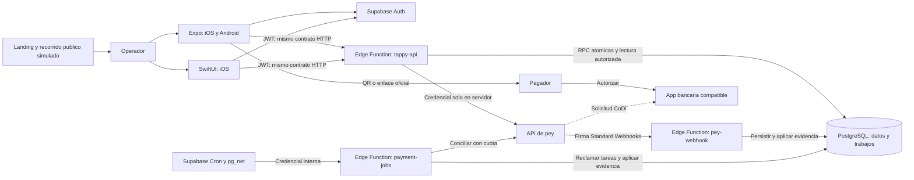

# Arquitectura propuesta

Propuesta v0.3 · 10 de noviembre de 2026. No es una arquitectura implementada ni una garantía de seguridad. La revisión actual recomienda Supabase como backend completo, sustituyendo la recomendación anterior de NestJS. El usuario pidió analizar esta alternativa; no se considera un servicio contratado ni una decisión final aceptada.

Equipo provisional de cuatro integrantes con stacks diversos; objetivo interno 5-dic. El usuario sí solicitó dos clientes en paralelo: Expo/TypeScript y SwiftUI nativo. Ambos consumen un único backend.

## 1. Recomendación

**Backend completo en Supabase: Auth + PostgreSQL + Edge Functions TypeScript + Cron. Clientes Expo/TypeScript y SwiftUI/Swift.** Una sola lógica de pagos y un contrato HTTP compartido. La landing se aloja como sitio estático; no se añade un servidor NestJS, Express, Go o Rust al MVP.

Supabase puede alojar tanto los datos y sesiones como el código de servidor que invoca pey. Su plataforma reduce servicios a desplegar, pero todavía debemos escribir autorización, reglas de cobro, firma de webhooks y pruebas. Las Edge Functions utilizan Deno y admiten dependencias compatibles; no equivalen a un proceso Node permanente.

La operación administrada no significa capacidad ilimitada o gasto acotado automáticamente. La base, el número de invocaciones y las conexiones tienen límites por configuración/plan. Presupuesto, disponibilidad, retención de logs y respaldo siguen pendientes.

| Alternativa | Ventaja para este proyecto | Costo o condición | Recomendación |
| --- | --- | --- | --- |
| Supabase completo | Un proveedor de backend; Auth, funciones, base y programación de tareas integrados | Código TS/SQL y disciplina de permisos, atomicidad y reintentos | **Nueva recomendación para el MVP** |
| Supabase Auth/Postgres + NestJS | Un proceso propio para lógica y trabajos prolongados, con acceso SQL convencional | Hosting y operación de un servicio adicional | Reservar para una necesidad concreta fuera de límites del runtime |
| Express directo + PostgreSQL/Auth administrados | Pocas abstracciones y arranque pequeño | Acordar manualmente módulos, validación, autorización y errores | Válido si es el stack más conocido del equipo |
| Go + servicios administrados | Buena opción con experiencia previa del equipo | Segundo lenguaje y contratos entre mobile y backend | Elegir solo si aporta experiencia real del equipo |
| Rust + servicios administrados | Control detallado del runtime | Mayor esfuerzo si el equipo no lo domina | Sin ventaja demostrada para este alcance |

Nest puede usar Express como adaptador; no son categorías completamente excluyentes. Las valoraciones de esfuerzo son inferencias para Tappy, no benchmarks. Elegir un lenguaje no resuelve por sí mismo abuso ni confirmaciones duplicadas.

Fuentes y análisis detallado: [investigación de Supabase](research/supabase-backend.md), [Edge Functions](https://supabase.com/docs/guides/functions), [límites del runtime](https://supabase.com/docs/guides/functions/limits).

## 2. System overview

El diagrama omite detalles bancarios. El webhook no usa sesión del operador; verifica firma propia del proveedor. Las tres funciones comparten módulos internos y reglas SQL. No se mantiene un servidor o worker siempre encendido.

## 3. Responsabilidades y stack

| Parte | Selección propuesta | Responsabilidad |
| --- | --- | --- |
| Cliente Expo | Expo, React Native, TypeScript, Expo Router | iOS/Android; UI y ciclo de vida propios |
| Cliente nativo | SwiftUI, Swift y SDK Swift de Supabase | iOS; mismo alcance funcional y contrato del servidor |
| Estado remoto | TanStack Query en Expo; modelo observable y tareas cancelables en SwiftUI | Recuperar estado del servidor; ninguna app decide pagos |
| Sesión nativa | Supabase Auth y almacenamiento seguro explícito en cada cliente | Identidad y renovación; validar Keychain/almacenamiento seguro por implementación |
| API | Edge Function `tappy-api` | Identidad, pertenencia, entradas y orquestación de creación/consulta |
| Persistencia | PostgreSQL administrado por Supabase | Integridad, transacciones, índices y trabajos durables |
| Acceso a datos | SDK de Supabase y RPC SQL con migraciones del CLI | Operaciones financieras atómicas dentro de una función SQL; sin ORM adicional |
| Proveedor | Adaptador `PeyGateway` | Traducción de contrato, unidades, estados y errores de pey |
| Webhooks | Edge Function `pey-webhook` | Firma, recepción durable y aplicación idempotente de evidencia |
| Trabajos | Tablas de eventos/trabajos + Cron + `payment-jobs` | Lotes pequeños, leases y recuperación; Queues es una alternativa, no una segunda cola necesaria |
| Actualización en ambas apps | REST con consulta periódica | Primer plano cada 3 s en espera; detener al salir o llegar a estado definitivo |
| Landing | Sitio estático con componentes React web y tokens existentes | Explicación, acceso a demo y materiales de entrega |
| Hosting API | Edge Functions de Supabase | Sin servicio NestJS ni hosting de backend adicional |
| Hosting web | Hosting estático/CDN | Entrega independiente del backend de pagos |

No se agregan Redis, otro backend ni un worker externo al inicio. Supabase también ofrece Realtime y Storage; no se necesitan para el recorrido mínimo. Realtime solo se activa con autorización por comercio y una mejora concreta sobre la consulta periódica. Storage sirve si después se necesitan activos; no se fuerza para alojar la landing.

Las claves publicables de Supabase identifican el proyecto; no son credenciales administrativas. Ninguna clave secreta, `service_role`, contraseña SQL o API key de pey va en la app ni en la landing. [JWT y verificación de Supabase](https://supabase.com/docs/guides/auth/jwts), [privilegios y RLS](https://supabase.com/docs/guides/database/postgres/row-level-security).

## 4. Límites de confianza y acceso

1. Ambos móviles inician sesión en Supabase Auth y envían su access token al mismo backend. Cada app mantiene su sesión y almacenamiento seguro; no comparte tokens copiándolos entre apps.
2. `tappy-api` exige identidad de usuario verificada, no solo una API key válida. La propuesta sigue el patrón oficial `auth: 'user'` de `withSupabase`, con `verify_jwt = true`, y autorización adicional por comercio. Revisar configuración exacta con versiones fijadas antes de implementar.
3. La identidad se resuelve a membresías de comercio en servidor. No se acepta `merchantId` del cliente como prueba de autorización.
4. Todas las consultas y mutaciones comprueban pertenencia, incluyendo detalles, intentos, métricas y solicitudes de conciliación. Un ID no adivinable no sustituye autorización.
5. El esquema financiero es privado, fuera de los esquemas expuestos por la Data API, sin permisos para `anon`/`authenticated`. El frontend no lee ni escribe tablas financieras directamente.
6. La función usa el cliente administrativo solo para RPC internas restringidas, y pasa como actor el sujeto obtenido de la identidad verificada, jamás un `userId` recibido del móvil. La RPC comprueba membresía y destinatario. Esa clave administrativa evita RLS: los filtros/autorización dentro de RPC deben probarse, no se asume protección automática. Credenciales de migración no se usan para peticiones.
7. Si más adelante se expone una tabla/vista a Supabase Data API o Realtime, se requiere diseño de grants/RLS y pruebas de permitir/denegar antes de exponerla. No asumir que una clave administrativa respeta esas políticas.
8. En demo solo se habilitan cuentas de operador y receptores previamente autorizados. El destinatario se obtiene del servidor, nunca de un campo libre del móvil.

9. Las RPC internas expuestas en el esquema de API permiten ejecución solo al rol de servidor correspondiente; revocar `PUBLIC`, `anon` y `authenticated`, incluidos privilegios por defecto. Las tablas financieras permanecen en esquema privado. Preferir `SECURITY INVOKER` con grants mínimos; cualquier `SECURITY DEFINER` necesita propietario limitado, `search_path` fijo/vacío y nombres calificados.
10. `pey-webhook` usa `verify_jwt = false` porque pey no envía JWT de Supabase; antes de cualquier efecto valida Standard Webhooks. `payment-jobs` usa autenticación de servicio, por ejemplo una clave secreta nombrada para automatizaciones con el patrón oficial `auth: 'secret:automations'`; `verify_jwt = false` allí no convierte al worker en público sin autenticación.

Fuente: [patrones oficiales de autenticación de funciones](https://supabase.com/docs/guides/functions/auth). Los detalles de permisos, encabezados y pruebas están en la [investigación](research/supabase-backend.md). No es suficiente configurar RLS si se opera con una clave que la evita.

## 5. Módulos lógicos

- `Identity`: validación de sesión y acceso a comercios.
- `Merchants`: perfil de demo y estado del receptor autorizado.
- `Collections`: cobros e intentos, reglas de importe y reintentos.
- `PeyGateway`: única salida a endpoints permitidos de pey; adaptador simulado solo en entorno de pruebas.
- `ProviderEvents`: firma, recepción durable y procesamiento idempotente.
- `Reconciliation`: consultas limitadas, asociaciones y revisión de casos inciertos.
- `Reporting`: historial, detalle y agregaciones de transferencias confirmadas.

Las pantallas y controladores delegan en el motor. La misma función de aplicación de evidencia es utilizada por webhooks y conciliación para evitar reglas divergentes.

En Supabase esos límites son módulos TS compartidos por funciones y operaciones SQL acotadas, no servicios desplegados por separado. La lógica de integración vive en TS; las restricciones y mutaciones que requieren atomicidad viven en PostgreSQL. Repositorio y contrato de ambos clientes: [apps en paralelo](05-apps-paralelas.md).

## 6. Modelo de datos mínimo

| Entidad | Campos principales | Invariantes |
| --- | --- | --- |
| `merchants` | id, displayName, timezone | Comercio de demo sin onboarding público |
| `merchant_memberships` | userId, merchantId, role | Unicidad de membresía; solo propietario en MVP |
| `receiving_accounts` | id, merchantId, providerAccountId, status, beneficiaryDisplay | Referencia autorizada; no almacenar CLABE completa salvo necesidad validada |
| `sales` | id, merchantId, amountCents, currency, reference, status, createdAt | Importe fijo positivo y referencia única |
| `payment_attempts` | id, saleId, method, status, providerRequestId, providerTransactionId?, expiresAt?, createdAt, version | Máximo un intento activo; IDs de proveedor solo cuando existen |
| `transactions` | id, merchantId, attemptId?, providerTransactionId, amountCents, currency, receivingAccountId, occurredAt?, receivedAt | Unicidad `(provider, environment, providerTransactionId)`; importes no editables |
| `webhook_events` | providerEventId, payloadHash, campos necesarios validados, status, receivedAt, retryAt | Unicidad `(provider, environment, providerEventId)` |
| `idempotency_requests` | merchantId, operation, key, requestHash, resourceId, outcome | Misma clave y mismo contenido recuperan resultado; contenido distinto genera conflicto |
| `reconciliation_jobs` | attemptId, reason, runAt, leaseUntil, tries, status | Un trabajo lógico por intento/razón; lease recuperable |
| `payment_exceptions` | saleId?, transactionId?, reason, createdAt, resolvedAt? | Registra duplicidad bancaria, importe distinto o asociación incierta |
| `operation_quotas` | scopeHash, operation, windowStart, count | Reservas atómicas antes de invocar operaciones de pago |

Todos los importes internos son enteros de centavos y se validan en rango seguro. La conversión a pesos de la API se hace exclusivamente en el adaptador, con comprobación de precisión al serializar y al recibir. La referencia interna no depende del rango limitado de `numRef` de pey. Fechas almacenadas en UTC.

`attemptId` de una transferencia puede ser nulo inicialmente si llegó evidencia no asociable; se conserva en incidencia y no se confirma una venta por aproximación de monto/hora. Los metadatos y IDs del proveedor deben permitir una asociación inequívoca.

## 7. Estados

### Cobro / Sale

- `OPEN`: no existe una transferencia exacta validada que cubra el cobro.
- `PAID`: existe evidencia confirmada del importe esperado.
- `REVIEW`: hay discrepancia o más de una transferencia bancaria distinta que exige revisión. Se conserva cuánto se recibió y si el importe esperado ya fue cubierto.

No se soportan pagos parciales intencionales en el MVP. Una transferencia de importe diferente va a revisión; no se redondea ni se inventa una diferencia.

### Intento / PaymentAttempt

| Estado | Significado | Salidas permitidas |
| --- | --- | --- |
| `CREATING` | Creación reservada; llamada pendiente o en curso | PENDING, RECONCILING, FAILED o PAID con evidencia anticipada |
| `PENDING` | Solicitud creada; sin evidencia de recepción | PAID, RECONCILING, EXPIRED; FAILED solo con evidencia definitiva |
| `RECONCILING` | Resultado incierto o verificación en curso | PENDING, PAID, EXPIRED, FAILED si se acredita |
| `EXPIRED` | Venció la ventana de uso que Tappy muestra para QR/push | PAID si llega evidencia auténtica tardía; RECONCILING al revisar |
| `PAID` | Transferencia correspondiente validada | No se degrada por eventos pendientes/antiguos |
| `FAILED` | Error definitivo y documentado que impidió crear/completar el intento | PAID solo si evidencia bancaria posterior obliga a corregirlo y abrir incidencia |

`draft` es estado de captura local. `unknown` es una presentación de incertidumbre. `cancelled` no existe como cancelación bancaria en este alcance. Ocultar o abandonar una pantalla no cancela la solicitud.

No imponer un `expiresAt` bancario a enlaces cuando su contrato no lo garantiza. Para ellos se conserva estado del proveedor y se controla el acceso local de la demo sin afirmar que el checkout dejó de cobrar.

## 8. Creación idempotente y fallos de red

1. Móvil genera una clave idempotente al confirmar una operación y la conserva al reintentar por pérdida de conexión.
2. En una transacción corta se verifica sesión, receptor activo, importe, cuota y ausencia de intento activo. Se reserva la clave y crea cobro/intento `CREATING` con referencia propia.
3. El bloqueo SQL se libera antes de la llamada a pey. No mantener una transacción SQL abierta durante red externa.
4. Se invoca pey con los IDs/metadata soportados; se guarda la respuesta y el estado con control de versión.
5. Si la respuesta es definitiva, aplicar transición correspondiente. Si hay timeout, desconexión o respuesta ambigua, marcar `RECONCILING`, nunca crear otro intento automáticamente.
6. Un webhook puede llegar antes de guardar la respuesta. El evento durable se asocia por metadata/IDs; si aún falta asociación se reprocesa. La respuesta tardía de creación no puede degradar un `PAID`.
7. La idempotencia interna no garantiza que pey deduplique POST. No repetir una creación ambigua hasta conciliar o revisar el caso; si no hay ID recuperable, conservar la incertidumbre y consultar registros/soporte autorizados.

En Supabase, reservar cuota/intento/idempotencia debe ser **una RPC SQL**, y aplicar transferencia/cobro/evento otra operación atómica. Varias llamadas consecutivas a `supabase.from(...)` no forman una transacción conjunta. El código externo a la transacción sigue en Edge Functions. [Funciones de base de datos](https://supabase.com/docs/guides/database/functions).

## 9. Webhooks y conciliación

Recepción: limitar tamaño → conservar bytes originales para verificación → verificar Standard Webhooks con secreto y tolerancia de timestamp → validar esquema → persistir evento y tarea en una transacción → responder 2xx después del commit. Ante falla de persistencia, responder error temporal; ante duplicado ya persistido, responder 2xx sin duplicar procesamiento.

Si un mismo ID de evento llega con un hash de contenido diferente, conservar la evidencia original, señalar el conflicto y revisar; no sobrescribir el evento ni aplicar una segunda mutación monetaria. Probar rotación del secreto conforme al procedimiento que confirme pey.

Procesamiento: asociar evento → verificar IDs de integración, cuenta, moneda e importe → consultar transferencia si falta evidencia → insertar transferencia con restricción única → bloquear el cobro y aplicar estado → actualizar tarea/evento en la misma transacción. No se hace red externa con bloqueo SQL sostenido.

Los eventos de enlace `paid` se concilian con transferencias, método permitido y cuenta configurada; ni redirección ni nombre del estado bastan. La cuenta receptora del enlace y la disponibilidad de CoDi deben validarse porque el endpoint de creación no expone los mismos campos que QR/push. Un `partial` se trata como incidencia en este MVP.

El proceso reclama tareas persistentes con bloqueo/lease; un reinicio permite recuperarlas. PostgreSQL ofrece bloqueo por filas para coordinar estas operaciones. [Documentación de bloqueos](https://www.postgresql.org/docs/current/explicit-locking.html). No depender únicamente de un temporizador en memoria.

Después de persistir el webhook se puede intentar aplicar la evidencia inmediatamente, con presupuesto corto, para cumplir el objetivo de actualización de pantalla. Si la ejecución termina, el evento/tarea sigue pendiente. Un Cron, inicialmente cada minuto, invoca el worker autenticado; reclama lotes acotados, respeta cuotas y completa o reprograma. El minuto de recuperación no es una garantía de que el pago bancario ocurra en ese plazo.

`EdgeRuntime.waitUntil` puede acelerar un trabajo ya persistido, pero no es garantía de durabilidad. No se duerme dentro de una función durante minutos para esperar un pago. [Cron](https://supabase.com/docs/guides/cron), [tareas en segundo plano](https://supabase.com/docs/guides/functions/background-tasks).

Propuesta inicial de conciliación: al vencer o ante incertidumbre, consultar con espera progresiva de 1, 2, 5 y 15 minutos; después reducir frecuencia dentro de una ventana operativa de 24 horas. Un caso sin resolver al cerrar la ventana pasa a revisión, no a fallo ni rechazo. Las notificaciones auténticas tardías siguen aceptándose. Ajustar la política a cuotas, retención y latencias confirmadas de pey.

Las consultas se centralizan y deduplican. Para QR, usar la consulta por ID de QR cuando no existe `transactionId`; recorrer paginación donde aplique. Para push/enlace, confirmar el contrato de consulta específico antes de activarlos. [Contrato y fuentes](research/pey-validation.md).

## 10. API interna orientativa

Son rutas de Tappy, no endpoints adicionales de pey. El contrato OpenAPI y los DTO exactos se congelan tras acordar alcance.

Las rutas de operador se sirven dentro de `tappy-api`, bajo `/functions/v1/tappy-api`. El webhook usa `/functions/v1/pey-webhook`; el worker `/functions/v1/payment-jobs` acepta solo identidad de servicio. No mezclar estos modos en una función que acepte indistintamente usuario y clave pública.

| Ruta | Función | Protección/resultado |
| --- | --- | --- |
| `GET /v1/merchant` | Perfil y receptor habilitado | JWT + membresía |
| `POST /v1/sales` | Crear obligación comercial | JWT, cuota, `Idempotency-Key`; no llama a pey |
| `POST /v1/sales/:id/attempts` | Crear QR/push/link | JWT, pertenencia, idempotencia, cuota, receptor del servidor |
| `GET /v1/sales/:id` | Estado persistido y detalle seguro | JWT + pertenencia; no consulta pey por cada lectura |
| `POST /v1/attempts/:id/reconcile` | Solicitar verificación | JWT + pertenencia, cuota; encola trabajo, no fuerza PAID |
| `GET /v1/sales` | Historial paginado y filtros | JWT; máximo 50 por página |
| `GET /v1/reports/summary` | Día/semana/mes | JWT; periodos y zona del comercio validados |
| `POST /functions/v1/pey-webhook` | Recibir evidencia | Firma; sin JWT ni CAPTCHA; respuesta tras persistencia |
| `POST /functions/v1/payment-jobs` | Procesar lote recuperable | Credencial interna; no disponible a usuarios ni claves publicables |

Errores: `400` entrada inválida, `401` sesión inválida, `404` recurso inexistente o ajeno, `409` conflicto de idempotencia/intento, `429` cuota con orientación de espera, `503` dependencia indisponible. El estado ambiguo tras un POST devuelve el ID local y la condición de conciliación, no instrucciones para repetir un pago. No filtrar errores crudos ni secretos del proveedor al cliente.

## 11. Seguridad y resistencia al abuso

La seguridad es un conjunto de controles verificables. Usar una API pública no obliga a exponer sus credenciales. Ninguna arquitectura garantiza ausencia absoluta de DoS; hay que limitar tanto tráfico entrante como operaciones costosas hacia pey. [OWASP: consumo de recursos](https://owasp.org/API-Security/editions/2023/en/0xa4-unrestricted-resource-consumption/).

| Riesgo | Control requerido | Cómo comprobar |
| --- | --- | --- |
| Extracción de secretos | Configuración del servidor/gestor de secretos, sin secretos en bundles, git ni logs | Inspección de artefactos y escaneo de secretos |
| Acceso a otros cobros | Autorización por recurso y comercio, esquema SQL privado | Pruebas cruzadas de todas las rutas |
| Pago inventado | Firma raw body, timestamp, esquema, cuenta/importe/IDs y consulta cuando falten datos | Eventos manipulados, firma inválida y destinatario distinto |
| Duplicación | Restricciones SQL para eventos, transacciones e idempotencia; bloqueo del cobro | Pruebas concurrentes y reprocesamiento |
| Abuso de push | Operadores autorizados, teléfonos consentidos de demo, cuota por comercio y número | Comprobar que el exceso no llama al proveedor |
| DoS/costos | Entrada administrada de Supabase más cuotas de negocio, límites de cuerpo/página/concurrencia, timeout y alertas de consumo | Prueba propia con proveedor simulado y revisión de cuotas/plan |
| Bypass de controles | Aplicar identidad y cuotas en toda ruta expuesta, incluidos endpoints directos de Supabase | Invocar URL de función/Data API directamente y comprobar denegación |
| Inyección/SSRF | RPC parametrizadas, DTO con campos admitidos y destinos salientes fijos | Inputs maliciosos y URLs de retorno no permitidas |
| Fuga de datos | Enmascarar teléfonos/cuentas, minimizar payload persistido, permisos y retención definida | Revisar logs, respuestas y permisos |
| Pérdida de trabajo | Persistencia antes de ACK, leases, Cron, reintentos acotados y alertas | Interrumpir función entre recepción y procesamiento |
| Intercepción/sesión | HTTPS/TLS, tokens nativos seguros y sesión renovable | Revisión de configuración y expiración de sesión |
| App alterada | Resolver medidas móviles exigibles por contrato y guías de pey | Evidencia de integridad y revisión exigida antes de habilitar producción |

No se añade otro proxy por defecto solo para el hackathon. Los límites de Auth no cubren automáticamente cada operación propia ni limitan el gasto en pey. Si se añade un proxy/WAF, la URL directa de Supabase no puede permitir evadir autorización/cuotas. Confirmar con el plan los controles de tráfico aplicables; el límite de negocio frena efectos externos, pero no garantiza evitar toda invocación facturable.

Cuotas iniciales **propuestas para la demo**, configurables y sujetas a límites de pey: 10 creaciones/minuto por comercio, 30 solicitudes al celular/día por comercio, máximo 3 por número consentido/10 minutos, 2 creaciones externas concurrentes por integración, 120 lecturas/minuto por operador y cuerpo de webhook de 256 KiB sujeto al tamaño real documentado. Aplicar topes de importe y de volumen diario antes de invocar pey; valores pendientes de acuerdo para las pruebas.

Las cuotas de operaciones bancarias se reservan atómicamente en la base; usar un hash con clave para identificar números en cuotas sin almacenarlos en texto plano innecesariamente. Los límites en variables de una Edge Function no coordinan ejecuciones concurrentes ni sobreviven interrupciones. La cuota durable debe vivir en SQL; revisar costes de las lecturas además de las creaciones.

El webhook necesita presupuesto de tráfico propio y nunca un challenge interactivo. Validar firma antes de procesar; aceptar eventos legítimos por orden de llegada sin degradar confirmados. No añadir allowlist de IP de pey si el proveedor no la garantiza.

Retención: guardar solo campos necesarios para recuperación/auditoría; los cuerpos crudos no se registran en logs. Si se requiere conservarlos y está permitido, cifrarlos con acceso restringido y plazo acordado. No fijar un plazo contractual o legal por suposición. Describir eliminación de datos de demo y restauración de respaldo antes de una prueba real.

## 12. Entornos, despliegue y observabilidad

- `local/test`: proveedor simulado, datos ficticios y eventos de prueba firmados con secreto de test.
- `demo-public`: recorrido sintético aislado, sin acceso a credenciales o datos de operaciones reales.
- `integration`: sandbox verificado si existe, o integración productiva autorizada con montos acotados; base, secretos, identificadores y UI claramente separados.
- Migraciones SQL versionadas con CLI, funciones/configuración en git, permisos mínimos y validación de disponibilidad/respaldos del plan Supabase. Presupuesto y hosting estático pendientes; no hay hosting Node adicional.
- Registrar `saleId`, `attemptId`, IDs de proveedor/evento, resultado y duración; ocultar teléfonos, CLABEs y tokens. Separar timestamp bancario, recepción y procesamiento.
- Alertas mínimas: firmas inválidas sostenidas, tareas atrasadas/fallidas, intentos inciertos y errores/cuotas de pey. Se puede usar el panel del hosting y consultas operativas inicialmente.
- En CI: tipos/lint TS y Swift, pruebas de dominio/contrato, integración SQL/funciones y compilación de ambas apps. Pruebas externas son controladas y no se ejecutan automáticamente con dinero.
- No hacer estrés o escaneo a pey; comprobar abuso contra el entorno propio con adaptador simulado. Cualquier prueba externa de carga requiere autorización del proveedor.

Límites documentados del runtime: 256 MB de memoria, 2 s de CPU por petición y duración del worker de 150 s en Free/400 s en planes de pago; espera de I/O no es CPU. Son límites técnicos, no tiempos objetivo de la app. Cada función debe terminar con margen y dejar trabajo recuperable. [Límites oficiales](https://supabase.com/docs/guides/functions/limits).

Versiones concretas de Expo, runtime de funciones, SDK TS/Swift, Swift/Xcode y herramientas se fijan por compatibilidad al iniciar. El SDK Standard Webhooks debe comprobarse en el runtime real antes de afirmar que la firma ya funciona. No se han instalado dependencias ni provisionado servicios.
