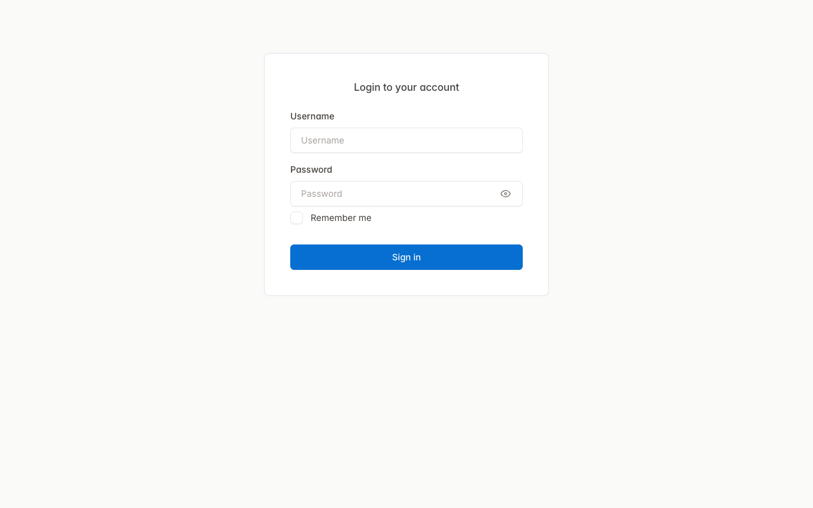
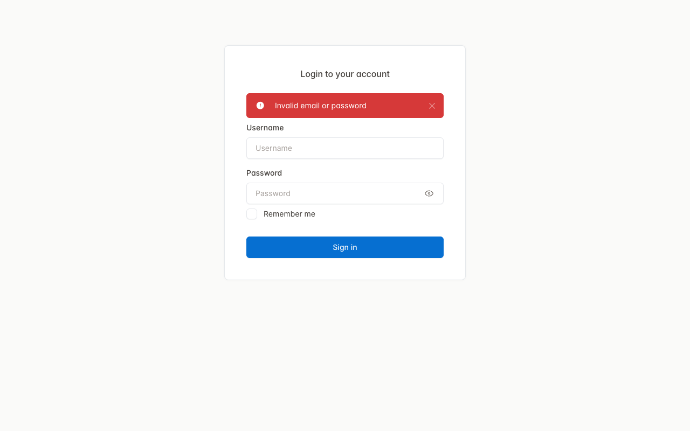
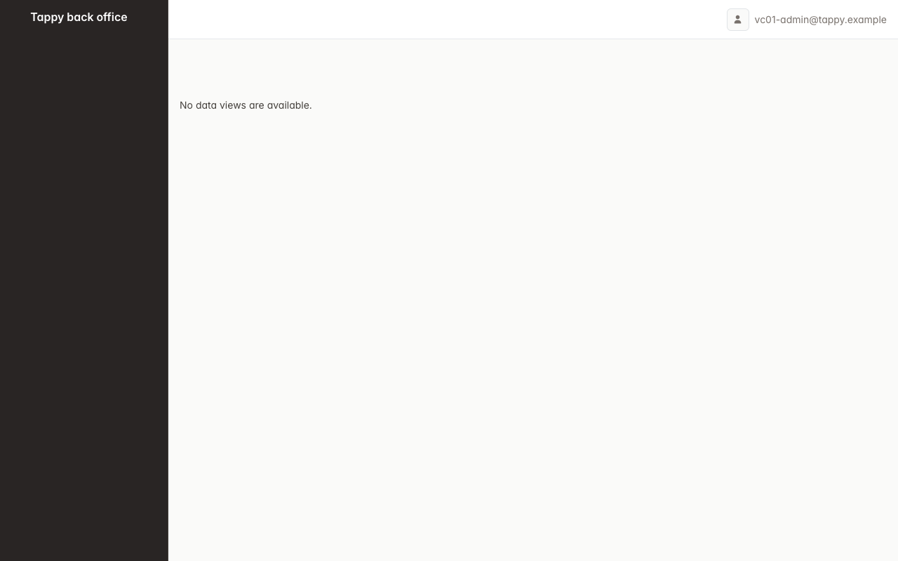

# Evidencia — B07 Entrar y salir de Starlette Admin

Ticket: [#15](https://github.com/luisjrez/Tappy/issues/15) · Historia: [H2 #2](https://github.com/luisjrez/Tappy/issues/2) · Protocolo: [TICKET_QUALITY_PROTOCOL](../planning/TICKET_QUALITY_PROTOCOL.md) · Manifiesto: [B07-admin-panel.toml](B07-admin-panel.toml)

## Revisiones y escenario

- Ticket, UC/AC/TC y comprobación: B07-UC01–UC03, B07-AC01–AC03, B07-TC01–TC03, B07-VC01.
- Modalidad: **resultado inicial** (panel nuevo en `/admin`). La API existente no cambia de contrato: los 7 contratos de `api_snapshots` siguen sin diferencias.
- Base: rama B06 `4211fb9` (PR #57, stack nativo #54). Revisión evaluada: candidato `da2dd79`.
- Entorno: macOS, Colima + Compose, Python 3.14.8, Starlette 1.10.0, starlette-admin 1.0.3. Navegador para capturas: Chrome (DevTools MCP), contexto aislado, viewport 1280×800, tema claro por defecto, escala 100 %. Fecha: 2026-11-20. Ejecutor: sesión local de desarrollo del autor del PR.
- Actores: administrador activo, operadora activa, anónimo. Datos: identidades sintéticas `vc01-…@tappy.example`.

## Diseño

- `tappy.backoffice.admin.mount_admin`: `BaseAdmin` de starlette-admin en `/admin` con `AdminAuthProvider` y `SessionMiddleware` (cookie `tappy_admin_session`, `HttpOnly`, `SameSite=Strict`, `Secure` según `TAPPY_ADMIN_SECURE_COOKIES`, por defecto `true`; `max_age` igual a la vida máxima de sesión).
- `AdminAuthProvider` (autenticación compartida con la API): `login` llama a `log_in(..., required_role=Role.ADMIN)` (operador o inactivo → mismo «Invalid email or password»); guarda access y refresh en la cookie firmada; `authenticate` resuelve con `find_access` y renueva con `renew` si el access expiró; exige rol admin; `logout` revoca la familia con `log_out` y limpia la cookie. Las operaciones de DB corren en el threadpool.
- CSRF: middleware de doble envío firmado de starlette-admin (cookie `starlette_admin_csrftoken` + campo `csrftoken`), activo para todo método no seguro bajo `/admin`, incluidos el login y el logout (`POST`).
- El logger de starlette-admin queda en `ERROR` para no registrar correos de intentos de login (registra `username` en INFO/WARNING).
- Presentación propia del panel (plantillas de starlette-admin); sin vistas de datos todavía (B08 añade operadores).

## Trazabilidad UC → AC → TC → test

| UC | AC | TC | Test real | Resultado |
| --- | --- | --- | --- | --- |
| B07-UC01 | B07-AC01 | B07-TC01 | `test_admin_enters_panel_and_logout_revokes_access` (login 303 → panel 200 con el correo → logout 303 → sin acceso; cero sesiones activas en DB) | PASS |
| B07-UC02 | B07-AC02 | B07-TC02 | `test_anonymous_visitor_is_sent_to_login`; `test_operator_cannot_enter_panel`; `test_api_bearer_token_does_not_open_panel`; `test_revoked_panel_session_loses_access` | PASS |
| B07-UC03 | B07-AC03 | B07-TC03 | `test_logout_without_valid_csrf_is_rejected_without_changes` (sin token, forjado, alterado → 403, panel sigue accesible, sesión sin revocar); `test_login_without_csrf_is_rejected` (403, cero sesiones); `test_panel_cookie_flags_follow_environment` (`HttpOnly`, `SameSite=Strict`, `Secure` solo si está configurado) | PASS |

## TDD

| Comportamiento | Red | Green |
| --- | --- | --- |
| Admin entra y el logout revoca | Sin panel: `assert None is not None` (no hay token CSRF en `/admin/login`) | `mount_admin`, `AdminAuthProvider` |
| Operador rechazado | Retirando `Role.ADMIN` del login del panel: falla `test_operator_cannot_enter_panel` | `required_role` en `log_in` |
| Logout revoca la sesión | Logout sin revocar: falla `test_admin_enters_panel_and_logout_revokes_access` | `log_out` |
| Sesión revocada pierde acceso | Tratando como válida una sesión inválida: falla `test_revoked_panel_session_loses_access` | `find_access`/`renew` |
| CSRF en mutaciones | Permitiendo `POST` como método seguro en el middleware: fallan los 3 casos de logout y el de login sin CSRF | CSRF de starlette-admin activo |
| Cookie según entorno | `https_only=False` fijo: falla el caso `Secure=True`; `SameSite=lax`: fallan ambos casos | `https_only` desde la configuración, `SameSite=Strict` |

Los tests de TC02/TC03 pasaron a la primera porque el comportamiento lo aporta el Green de TC01 y el CSRF de starlette-admin; el Red se observó retirando temporalmente cada comportamiento y restaurándolo (todos revertidos). Una primera mutación de CSRF fue inválida (faltaba el import) y se repitió correctamente.

Refactor con suite verde: `LoginCredentials` agrupa correo y contraseña en `log_in`; el panel no duplica reglas de identidad, solo presenta y guarda las credenciales en su cookie.

## B07-VC01 — Resultado inicial del panel

Capturas del recorrido (servidor real `python -m tappy`, `TAPPY_ADMIN_SECURE_COOKIES=false` por HTTP local):

| Vista / rol / TC | Captura | Comprobación |
| --- | --- | --- |
| `/admin/` anónimo → login (TC02) |  | Redirección a `/admin/login?next=…`; formulario sin datos administrativos |
| Login de operadora (TC02) |  | Alerta «Invalid email or password»; contraseña oculta |
| Admin dentro del panel (TC01) |  | Identidad real `vc01-admin@tappy.example` en el menú; «No data views are available» (sin vistas aún) |
| `/admin/` tras pulsar Logout (TC01) |  | De vuelta al login; en DB `activas=0` de 1 sesión |

Respuestas HTTP con una sesión de admin válida (cookies y tokens redactados):

```text
GET  /admin/                               → 200
POST /admin/logout (sin csrftoken)         → 403 "CSRF token missing"
POST /admin/logout (csrftoken alterado)    → 403 "CSRF token invalid"
GET  /admin/ tras los intentos rechazados  → 200 (la sesión sigue activa: sin cambios)
Set-Cookie: tappy_admin_session=<redactado>; path=/; Max-Age=2592000; httponly; samesite=strict
```

En local la cookie no lleva `Secure` porque `TAPPY_ADMIN_SECURE_COOKIES=false`; con el valor por defecto (`true`) sí (test parametrizado). El log del servidor no contiene correos ni contraseñas (0 coincidencias). Teclado/foco: el formulario de login se completó y envió por su árbol de accesibilidad (campos «Username», «Password», botón «Sign in»); no se cambiaron interacciones propias. Datos de prueba eliminados al terminar. Estado VC01: **PASS** (resultado inicial).

## Checks

Pendiente de registrar sobre la revisión final.

## Supresiones

Sin supresiones nuevas.

## Umbral

AC PASS / AC aplicables = 3/3 = **100%**.

## Review Standards/Spec

Pendiente.
