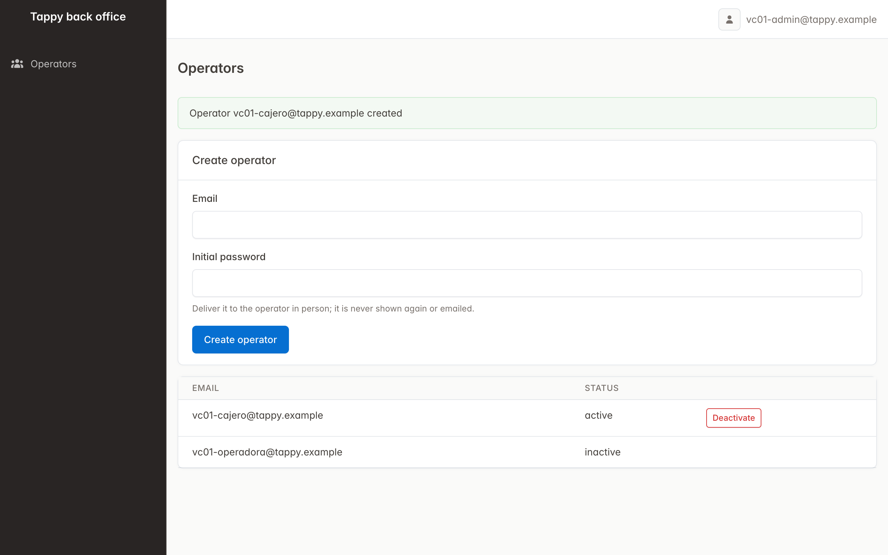
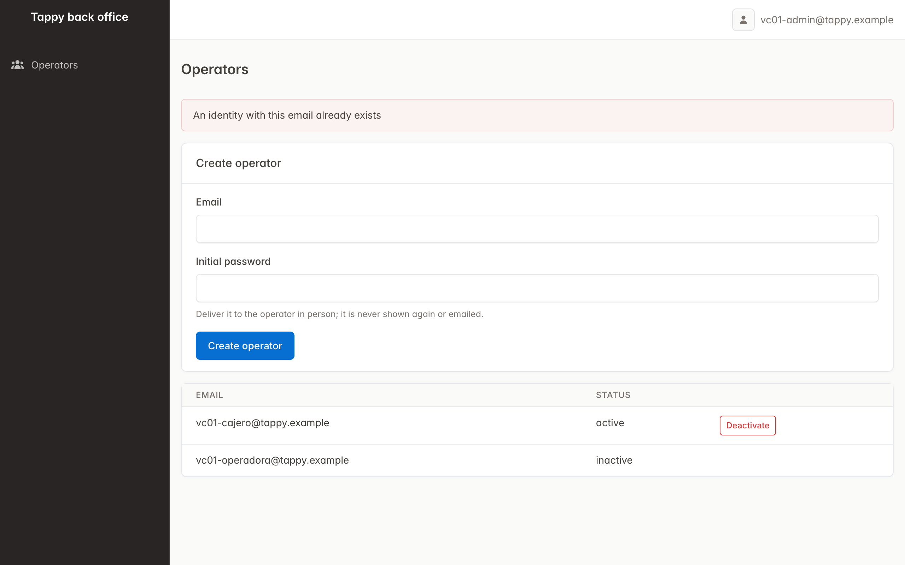

# Evidencia — B08 Administrar operadores autorizados

Ticket: [#16](https://github.com/luisjrez/Tappy/issues/16) · Historia: [H2 #2](https://github.com/luisjrez/Tappy/issues/2) · Protocolo: [TICKET_QUALITY_PROTOCOL](../planning/TICKET_QUALITY_PROTOCOL.md) · Manifiesto: [B08-operator-admin.toml](B08-operator-admin.toml)

## Revisiones y escenario

- Ticket, UC/AC/TC y comprobación: B08-UC01–UC03, B08-AC01–AC03, B08-TC01–TC03, B08-VC01.
- Modalidad: **resultado inicial** (API `/operators` nueva y vista «Operators» nueva en el panel). Los contratos existentes no cambian (8 contratos sin diferencias, incluido `operators-unauthenticated` aprobado en `c3d72c4`). La vista índice del panel de B07 ahora muestra el menú «Operators»: cambio esperado de la navegación.
- Base: rama B07 `31149bd` (PR #58, stack nativo #54). Revisión evaluada: candidato `c3d72c4`.
- Entorno: macOS, Colima + Compose, Python 3.14.8, starlette-admin 1.0.3; Chrome (DevTools MCP), contexto aislado, 1280×800, tema claro, escala 100 %. Fecha: 2026-11-20. Ejecutor: sesión local de desarrollo del autor del PR.
- Actores: administrador, operadora, anónimo. Datos: identidades y frases sintéticas `vc01-…@tappy.example`.

## Diseño

- Casos de uso compartidos `tappy.identity.operators`: `create_operator` (reutiliza `provision_identity` con rol `operator`: correo normalizado, política de contraseña, unicidad sin mayúsculas, sin cambios silenciosos), `list_operators`, `find_operator`, `deactivate_operator` (solo identidades con rol `operator`; `FOR NO KEY UPDATE`; reutiliza `deactivate`, que marca inactiva y revoca todas sus sesiones).
- Credencial inicial operativa: el administrador define una contraseña inicial que entrega en persona; pasa la misma política que el resto, nunca se devuelve, ni se muestra de nuevo, ni se envía por correo.
- API (`tappy.identity.operators_router`): `POST /operators` 201 · 409 · 422, `GET /operators`, `GET /operators/{reference}`, `POST /operators/{reference}/deactivate`. Dependencia `CurrentAdmin` (401 sin token válido, 403 «Administrator role required»).
- Panel: `OperatorsView` (`CustomView` propia, plantilla `operators.html`) con formulario de alta y botón de desactivar por fila; cada formulario lleva el token CSRF. Sin `ModelView` ni CRUD genérico sobre identidades.
- Sin registro público: las únicas rutas `POST` de la API son login/refresh/logout (públicas por naturaleza) y las de operadores (solo admin); un test fija ese conjunto.

## Trazabilidad UC → AC → TC → test

| UC | AC | TC | Test real | Resultado |
| --- | --- | --- | --- | --- |
| B08-UC01 | B08-AC01 | B08-TC01 | `test_admin_creates_active_operator_without_echoing_the_secret` (201 sin contraseña, `GET` recupera el operador activo, la operadora inicia sesión con la credencial inicial); `test_invalid_initial_credential_is_rejected_without_echo`; `test_admin_creates_operator_from_form_and_sees_it_listed` | PASS |
| B08-UC02 | B08-AC02 | B08-TC02 | `test_non_admins_cannot_create_or_deactivate_operators` (anónimo 401, operadora 403 en alta, desactivación y listado; sin cambios en DB); `test_there_is_no_public_sign_up_route`; `test_anonymous_form_submission_changes_nothing`; `test_form_without_csrf_changes_nothing` | PASS |
| B08-UC03 | B08-AC03 | B08-TC03 | `test_repeated_email_is_rejected_without_duplicate` (409, mismo conteo); `test_deactivated_operator_session_stops_authorizing` (access y refresh de la operadora → 401; estado `inactive`); `test_admin_identities_are_not_managed_as_operators` (404); `test_repeated_email_in_form_is_rejected_without_duplicate`; `test_deactivation_from_panel_revokes_operator_session` | PASS |

## TDD

| Comportamiento | Red | Green |
| --- | --- | --- |
| Alta por API | `KeyError: 'reference'` (sin ruta) | `operators.py`, `operators_router.py`, `CurrentAdmin` |
| Alta desde el panel | `assert 404 == 201` | `OperatorsView` + plantilla |
| Solo admins | Sin Red propio; mutación sin chequeo de rol en `current_admin` → falla el caso 403 | `CurrentAdmin` |
| Alta crea operadores, no admins | Mutación con rol admin → fallan alta por API y por panel | `Role.OPERATOR` |
| Desactivar cambia estado y corta acceso | Mutación sin cambiar estado → falla `…stops_authorizing` | `deactivate` |
| Solo operadores son gestionables | Mutación sin filtro de rol → falla `…not_managed_as_operators` | Filtro `role = operator` |

TC02/TC03 restantes (duplicados, CSRF, anónimo, signup) pasaron a la primera porque los aportan `provision_identity`, el CSRF y la autenticación del panel de tickets anteriores; quedan como regresión.

Refactor con suite verde: `provision_identity(role)` compartido por `bootstrap-admin` y el alta de operadores; `deactivate(identity)` compartido por el comando y la gestión de operadores; API y panel llaman a los mismos casos de uso.

## B08-VC01 — Resultado inicial de API y panel

API, proceso real (`python -m tappy`), tokens redactados:

| Petición | Status | Cuerpo |
| --- | --- | --- |
| `POST /operators` (admin) | 201 | `{"reference":"2f767ec4-3f54-45cf-8230-19e8ec2a5830","email":"vc01-operadora@tappy.example","role":"operator","status":"active"}` |
| `POST /operators` mismo correo en mayúsculas | 409 | `{"detail":"An identity with this email already exists"}` |
| `POST /operators` con token de operadora | 403 | `{"detail":"Administrator role required"}` |
| `POST /operators` sin token | 401 | `{"detail":"Not authenticated"}` |
| `POST /operators/{ref}/deactivate` (admin) | 200 | `{… "status":"inactive"}` |
| `GET /auth/me` con el token de la operadora desactivada | 401 | `{"detail":"Not authenticated"}` |
| `GET /operators/{ref}` | 200 | `{… "status":"inactive"}` |

Panel (`/admin/operators`, mismo servidor):

| Vista / TC | Captura | Comprobación |
| --- | --- | --- |
| Alta desde el formulario (TC01) |  | Mensaje «Operator vc01-cajero@tappy.example created»; fila activa con botón Deactivate; la contraseña no aparece |
| Correo repetido en mayúsculas (TC03) |  | «An identity with this email already exists»; lista sin duplicados |
| Desactivación desde el panel (TC03) |  | «Operator … deactivated»; fila `inactive` sin botón |

El log del servidor no contiene contraseñas (0 coincidencias). Teclado/foco: formularios con etiquetas asociadas (`Email`, `Initial password`) completados por su árbol de accesibilidad. Datos de prueba eliminados al terminar. Estado VC01: **PASS** (resultado inicial).

## Checks

Pendiente de registrar sobre la revisión final.

## Supresiones

Sin supresiones nuevas.

## Umbral

AC PASS / AC aplicables = 3/3 = **100%**.

## Review Standards/Spec

Pendiente.
