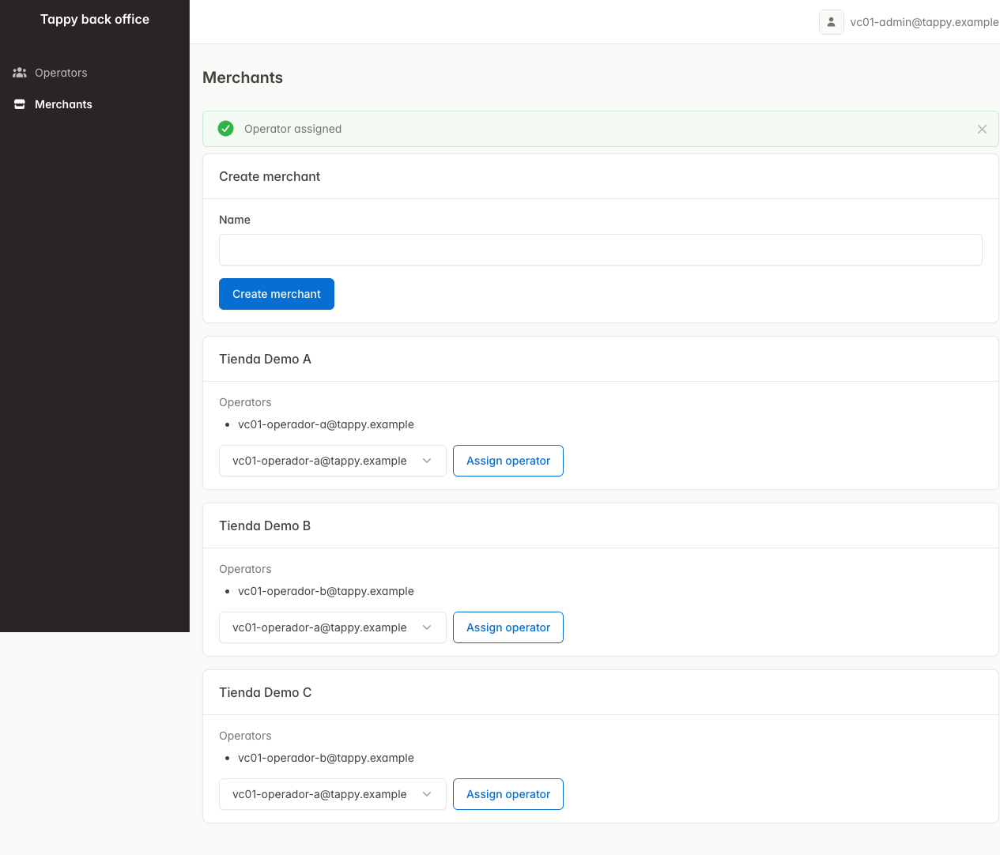
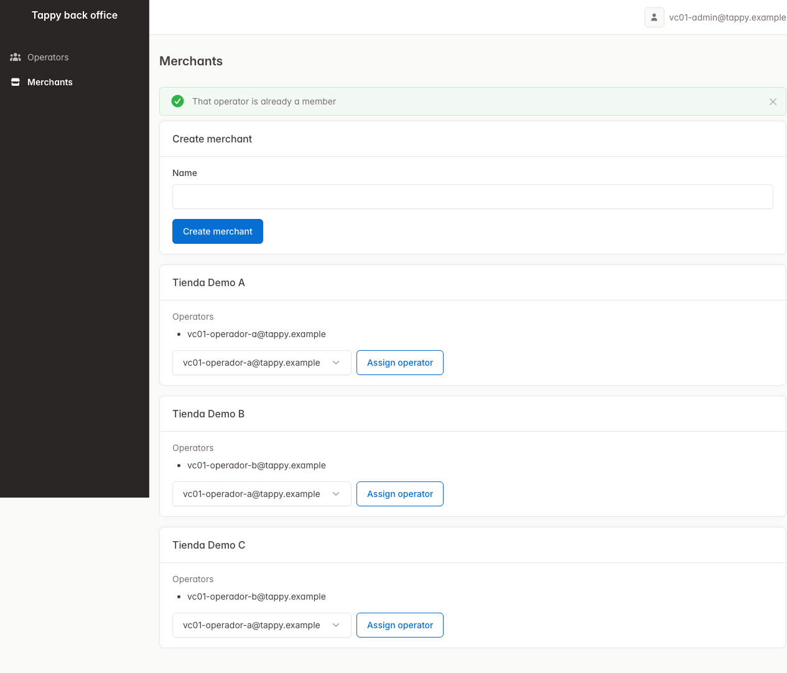

# Evidencia — B09 Configurar comercio y membresía

Ticket: [#17](https://github.com/luisjrez/Tappy/issues/17) · Historia: [H3 #3](https://github.com/luisjrez/Tappy/issues/3) · Protocolo: [TICKET_QUALITY_PROTOCOL](../planning/TICKET_QUALITY_PROTOCOL.md) · Manifiesto: [B09-merchant-membership.toml](B09-merchant-membership.toml)

## Revisiones y escenario

- Ticket, UC/AC/TC y comprobación: B09-UC01–UC03, B09-AC01–AC03, B09-TC01–TC03, B09-VC01.
- Modalidad: **resultado inicial** (API `/merchants` y vista «Merchants» nuevas). Contratos existentes sin diferencias; nuevo `merchants-unauthenticated` (401) aprobado en `7758b73`. El menú del panel suma «Merchants» (cambio esperado de navegación).
- Base: rama B08 `8610294` (PR #59) en el stack principal #54. Revisión evaluada: candidato `7758b73`; correcciones de review en `f3bf054` y `e57ec60` (revisión final evaluada; VC01 re-ejecutada sobre ella).
- Entorno: macOS, Colima + Compose, Python 3.14.8; Chrome (DevTools MCP), 1280×800 (capturas de página completa). Fecha: 2026-11-20. Ejecutor: sesión local de desarrollo del autor del PR.
- Datos: comercios «Tienda Demo A/B» y operadores sintéticos.

## Diseño

- `tappy.merchants`: `Merchant` y `Membership` (único por comercio+identidad), migración `0005_merchants_memberships` (sobre `0004`; el stack lateral de B41/B42 también parte de `0004` y deberá reencadenar su `0005` al integrarse).
- Autorización centralizada por pertenencia (`scoped`/`accessible_merchant`): administradores ven todo; operadores solo comercios con membresía. Fuera de alcance → `404` («Merchant not found»), sin revelar existencia. Los IDs en ruta o query no amplían el alcance.
- API: `GET /merchants`, `GET /merchants/{id}` (identidad activa, acotado); `POST /merchants`, `POST /merchants/{id}/members` solo admin (`403` operador, `401` anónimo). Asignación idempotente: repetir → `200` con la membresía original intacta (un único camino: restricción única con savepoint). El nombre se normaliza y valida en el dominio (1–120 caracteres, `MERCHANT_NAME_MAX_LENGTH` compartido por modelo, esquema y plantilla), así que API y panel rechazan igual. Solo operadores activos son asignables (`422`); la asignación toma la identidad `FOR SHARE`, serializada con la desactivación (`FOR NO KEY UPDATE`), para no vincular a un operador que se está desactivando. El listado carga las membresías en una sola consulta.
- Panel: vista propia «Merchants» (sin CRUD genérico) para crear comercios y asignar operadores activos; CSRF y POST→redirect→GET con mensajes flash.

## Trazabilidad UC → AC → TC → test

| UC | AC | TC | Test real | Resultado |
| --- | --- | --- | --- | --- |
| B09-UC01 | B09-AC01 | B09-TC01 | `test_operator_sees_only_the_merchant_it_belongs_to` (con dos comercios, la operadora A solo ve A con su membresía una vez); `test_own_merchant_is_readable_and_anonymous_gets_nothing`; `test_admin_creates_merchant_and_assigns_operator_from_panel` | PASS |
| B09-UC02 | B09-AC02 | B09-TC02 | `test_operator_cannot_read_or_modify_a_foreign_merchant` (GET B → 404, unirse a B → 403, `merchant_id` extra en el cuerpo → 422, `?merchant_id=B` no amplía; B sin cambios); `test_merchant_form_requires_csrf_and_an_admin`; `test_blank_or_overlong_names_are_rejected` (API) y `test_panel_rejects_blank_or_overlong_names_without_creating` (panel: 303 + mensaje, sin filas) | PASS |
| B09-UC03 | B09-AC03 | B09-TC03 | `test_repeated_assignment_keeps_one_original_membership` (201 → 200, una fila, `created_at` original); `test_only_active_operators_can_be_assigned`; `test_concurrent_assignments_keep_a_single_membership`; `test_assignment_racing_a_deactivation_never_links_an_inactive_operator` | PASS |

## TDD

| Comportamiento | Red | Green |
| --- | --- | --- |
| Alta, asignación y listado acotado | `assert 404 == 201` | Modelos, migración, servicio, router |
| Vista del panel | Formulario inexistente: falla el alta desde el panel | `MerchantsView` + plantilla |
| Aislamiento y permisos | Sin Red propio (aportados por el Green). Mutaciones: operador ve todos → fallan TC01 y TC02; asignación sin `ADMIN_ONLY` → falla TC02 | `scoped`, `ADMIN_ONLY` |
| Carrera asignación/desactivación (review) | `assert 201 == 422`: la asignación leía al operador sin bloqueo y lo vinculaba mientras otra transacción lo desactivaba | `assignable_operator` con `operator_by_reference(...).with_for_update(read=True)`. El test espera en `pg_stat_activity` a que la asignación quede bloqueada (sin `sleep` fijo); mutación sin bloqueo → «assignment never waited for the deactivation lock» |
| Asignaciones concurrentes (review) | Sin Red: la restricción única con savepoint ya lo garantizaba; el test lo fija (4 hilos → un 201 y tres 200, una fila) | — |
| Nombre largo desde el panel (re-review) | `StringDataRightTruncation` → 500 con 121 caracteres; mensaje ausente con nombre en blanco | `clean_name` valida longitud con `MERCHANT_NAME_MAX_LENGTH` |
| Idempotencia | Se retira la comprobación previa (re-review): la restricción única con savepoint garantiza una sola fila; los tests de repetición y concurrencia siguen verdes | — |

Refactor con suite verde: el panel usa `list_all_merchants` en lugar de un actor sintético; mapeo de errores compartido en el router. Tras la review: se retira `PATCH /merchants/{id}` (fuera del alcance de B09), búsqueda de comercio única (`merchant_or_raise`), orden compartido (`ordered_merchants`), reutilización de `operator_by_reference`, regla «asignable» en el dominio (`assignable_operators`), métodos del panel `load_page`/`create`/`assign`, `except ValueError` acotado al parseo del UUID y membresías en lote (`describe_all`, sin N+1).

## B09-VC01 — Resultado inicial de API y panel

API (proceso real `python -m tappy` sobre `e57ec60`, DB en `0005_merchants_memberships`; UUIDs normalizados como `<uuid>`):

| Petición | Status | Respuesta |
| --- | --- | --- |
| `POST /merchants` (admin, «Tienda Demo A») | 201 | `{"id": "<uuid>", "name": "Tienda Demo A", "members": []}` |
| `POST /merchants` (admin, 121 caracteres) | 422 | `string_too_long`, `max_length: 120` |
| `POST /merchants/{A}/members` (admin, operador A) | 201 | `{"id": "<uuid>", "name": "Tienda Demo A", "members": [{"reference": "<uuid>", "email": "vc01-operador-a@tappy.example"}]}` |
| Mismo POST repetido | 200 | Mismo cuerpo, sin duplicado |
| `GET /merchants` (operador A) | 200 | `[{"id": "<uuid>", "name": "Tienda Demo A", "members": [{…"vc01-operador-a@tappy.example"}]}]` |
| `GET /merchants/{B}` (operador A) | 404 | `{"detail": "Merchant not found"}` |
| `POST /merchants/{B}/members` (operador A, unirse a B) | 403 | `{"detail": "Administrator role required"}` |
| `PATCH /merchants/{B}` (operador A) | 405 | `{"detail": "Method Not Allowed"}` (ruta retirada) |
| `GET /merchants` (admin) | 200 | `[("Tienda Demo A", 1), ("Tienda Demo B", 1)]` |

Panel (`/admin/merchants`):

| Vista | Captura | Comprobación |
| --- | --- | --- |
| Crear «Tienda Demo C» desde el panel y asignarle el operador B |  | «Operator assigned»; cada comercio muestra solo sus operadores |
| Repetir la asignación del operador A |  | «That operator is already a member»; sin duplicados |

Capturas re-tomadas sobre `e57ec60` (Chrome DevTools, 1280×800, página completa). Datos de prueba eliminados al terminar (identidades, comercios, membresías y sesiones en 0). Estado VC01: **PASS** (resultado inicial).

## Checks

`uv run python -m quality.check` sobre `e57ec60`: PASS format, lint, types (mypy strict, 83 archivos), hygiene, migrations (upgrade/downgrade/upgrade + `alembic check`), tests (155 passed, 0 fallos, Postgres real aislado), api (contratos sin diferencias). Los tests de concurrencia se repitieron 3 veces seguidas en verde. `evidence` queda en FAIL solo por la review pendiente.

## Supresiones

Sin supresiones nuevas.

## Umbral

AC PASS / AC aplicables = 3/3 = **100%**.

## Review Standards/Spec

Pendiente.
