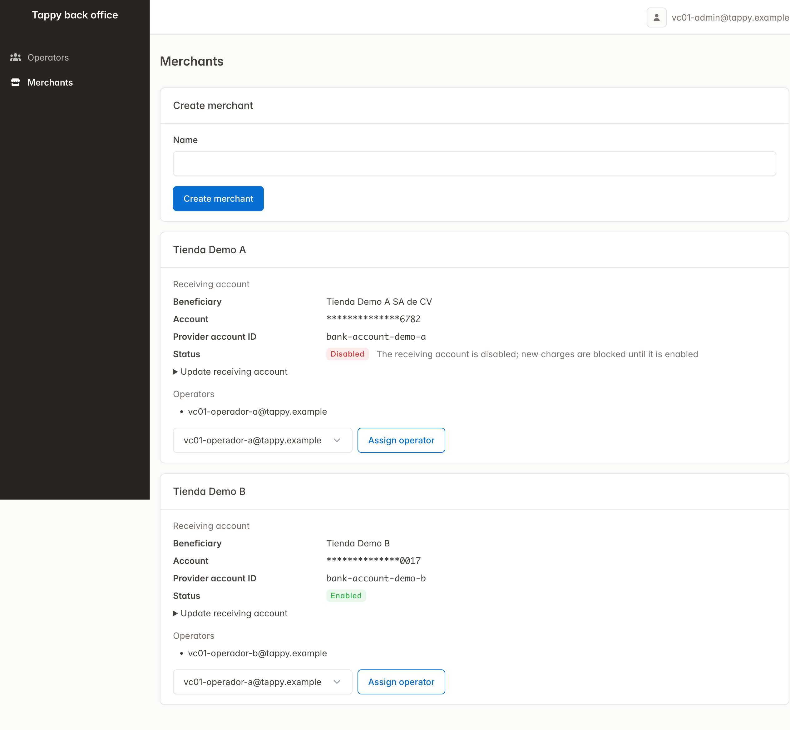
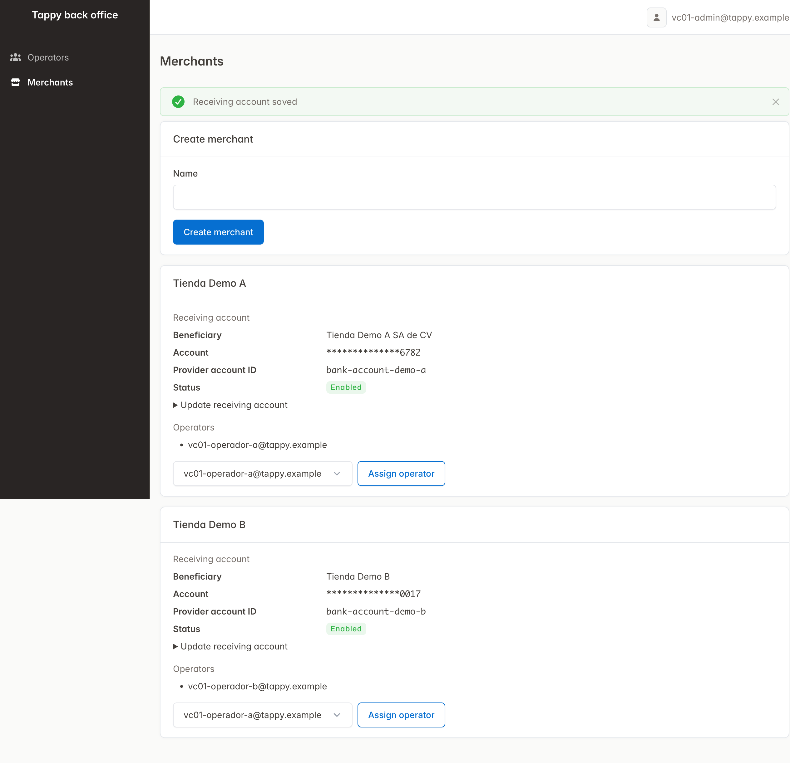
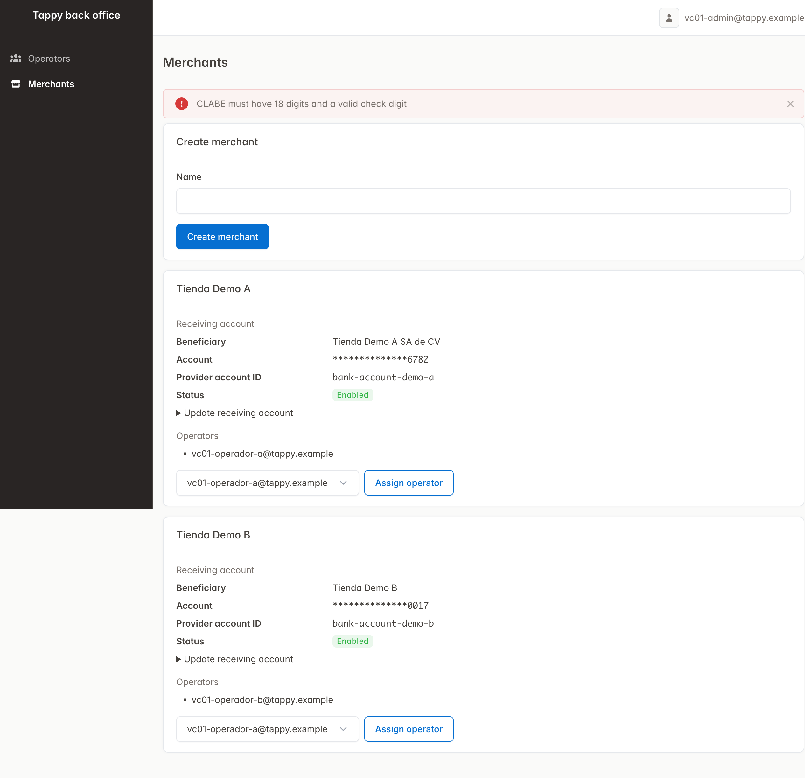

# Evidencia — B10 Configurar y consultar receptor

Ticket: [#18](https://github.com/luisjrez/Tappy/issues/18) · Historia: [H3 #3](https://github.com/luisjrez/Tappy/issues/3) · Protocolo: [TICKET_QUALITY_PROTOCOL](../planning/TICKET_QUALITY_PROTOCOL.md) · Manifiesto: [B10-receiver.toml](B10-receiver.toml)

## Revisiones y escenario

- Ticket, UC/AC/TC y comprobación: B10-UC01–UC03, B10-AC01–AC03, B10-TC01–TC03, B10-VC01.
- Modalidad: **resultado inicial** (API de receptor y sección «Receiving account» del panel nuevas). Contratos existentes sin diferencias; nuevos `receiver-unauthenticated` e `issuance-check-unauthenticated` (401) aprobados en `f14bf51`.
- Base: rama B09 `7b756c7` (PR #63) en el stack principal #54. Revisión evaluada: candidato `f14bf51`.
- Entorno: macOS, Colima + Compose, Python 3.14.8; Chrome (DevTools MCP), 1280×800 (capturas de página completa). Fecha: 2026-11-21. Ejecutor: sesión local de desarrollo del autor del PR.
- Datos: comercios «Tienda Demo A/B», operadores sintéticos, referencias de proveedor `bank-account-demo-*` y CLABE ficticias con dígito verificador válido (no corresponden a cuentas reales). Ninguna integración bancaria real: el receptor se registra como referencia ya autorizada; su activación real con el proveedor queda fuera de B10 (requisito externo).

## Diseño

- `ReceivingAccount` (migración `0006_receiving_accounts`): a lo sumo uno por comercio (`merchant_id` único) y una referencia de proveedor no compartible entre comercios (`provider_account_id` único → `409`).
- La CLABE se valida (18 dígitos + dígito verificador 3-7-1) y solo se guardan sus últimos 4 dígitos; la lectura expone `masked_account` (`**************1234`). La CLABE entra como `SecretStr`, así que un error de validación no la refleja. El `provider_account_id` no se expone en la API (sí al admin en el panel).
- API: `PUT /merchants/{id}/receiver` (solo admin, crea o reemplaza; bloquea la fila del comercio `FOR NO KEY UPDATE` para serializar configuraciones), `GET /merchants/{id}/receiver` (acotado por pertenencia; `404` si no hay receptor), `POST /merchants/{id}/issuance-check` (acotado; cuerpo sin campos → un destinatario enviado por el cliente es `422`; `409` con explicación si no hay receptor o está deshabilitado).
- Regla única de habilitación (`issuance_block` / `issuing_receiver` en `tappy.merchants.receivers`): la usan la lectura, la comprobación previa y el panel, y la reutilizarán los canales de emisión (B11+). Deshabilitar es un cambio de estado: no borra el receptor ni datos del comercio.
- Panel: cada comercio muestra beneficiario, cuenta enmascarada, referencia del proveedor, estado y motivo de bloqueo; formulario para configurar/actualizar con CSRF y POST→redirect→GET.

## Trazabilidad UC → AC → TC → test

| UC | AC | TC | Test real | Resultado |
| --- | --- | --- | --- | --- |
| B10-UC01 | B10-AC01 | B10-TC01 | `test_operator_reads_beneficiary_and_masked_account_of_own_receiver` (admin configura, operador A lee beneficiario, cuenta enmascarada y habilitación; sin CLABE ni referencia del proveedor en la respuesta); `test_full_account_number_is_never_stored`; `test_invalid_receiver_configuration_is_rejected` (6 casos, sin reflejar la CLABE); `test_only_administrators_configure_receivers`; `test_unknown_merchant_has_no_receiver`; `test_racing_first_configurations_keep_one_receiver`; `test_admin_configures_and_disables_receiver_from_panel`; `test_panel_rejects_invalid_receiver_without_echoing_the_account` | PASS |
| B10-UC02 | B10-AC02 | B10-TC02 | `test_disabled_receiver_blocks_issuance_with_an_explanation`; `test_merchant_without_receiver_cannot_issue`; `test_requests_cannot_choose_a_foreign_receiver` (receptor de B en el cuerpo → 422; comprobación/lectura de B → 404; reutilizar la referencia de B → 409; A sin cambios) | PASS |
| B10-UC03 | B10-AC03 | B10-TC03 | `test_disabling_keeps_the_receiver_and_merchant_records` (mismo registro y miembros tras deshabilitar; comprobación 409 con explicación; reactivar vuelve a permitir); `test_admin_configures_and_disables_receiver_from_panel` (explicación visible en el panel) | PASS |

### Alcance de TC03 en la frontera de B10

B10 depende solo de B09: todavía no existen cobros (B11) ni historial (B27). «Historial permanece» se verifica aquí como lo que B10 controla: deshabilitar el receptor no borra ni altera el receptor, el comercio ni sus membresías, y los nuevos cobros quedan bloqueados con explicación por la regla compartida. Arrastre obligatorio: B11 debe emitir solo a través de `issuing_receiver` (con bloqueo de la fila del receptor frente a la deshabilitación) y B27 debe comprobar que el historial confirmado sigue visible con el receptor deshabilitado.

## TDD

| Comportamiento | Red | Green |
| --- | --- | --- |
| Configurar, leer enmascarado y comprobación previa | 13 de 14 tests fallan: `assert 404 == 200/409/422/403` (rutas inexistentes) | Modelo, migración, `receivers.py`, rutas |
| Panel del receptor | `assert 404 == 303` (ruta del panel inexistente) | `submit_receiver` + plantilla |
| Configuraciones simultáneas | Mutación sin bloqueo del comercio: `UniqueViolation receiving_accounts_merchant_id_key` (500). El test abre una transacción que configura primero y espera en `pg_stat_activity` a que la petición quede bloqueada | `with_for_update(key_share=True)` sobre el comercio |
| Destinatario arbitrario | Sin Red propio: el cuerpo estricto del Green ya lo rechaza; mutación `extra="ignore"` → falla TC02 | `IssuanceCheckRequest` con `extra="forbid"` |

Refactor con suite verde: `issuance_block` como regla única usada por la lectura, la comprobación previa y el panel; helper de tests `configure` con un payload base.

## B10-VC01 — Resultado inicial de API y panel

API (proceso real `python -m tappy` sobre `f14bf51`, DB en `0006_receiving_accounts`; UUIDs normalizados como `<uuid>`):

| Petición | Status | Respuesta |
| --- | --- | --- |
| `POST /merchants/{A}/issuance-check {}` (operador A, sin receptor) | 409 | `{"detail": "No receiving account is configured; new charges are blocked"}` |
| `PUT /merchants/{A}/receiver` (admin, CLABE con dígito verificador inválido) | 422 | `{"detail": "CLABE must have 18 digits and a valid check digit"}` |
| `PUT /merchants/{A}/receiver` (operador A) | 403 | `{"detail": "Administrator role required"}` |
| `PUT /merchants/{A}/receiver` (admin, activo) | 200 | `{"beneficiary_name": "Tienda Demo A SA de CV", "masked_account": "**************6782", "enabled": true, "can_issue": true, "blocked_reason": null}` |
| `GET /merchants/{A}/receiver` (operador A) | 200 | `{"beneficiary_name": "Tienda Demo A SA de CV", "masked_account": "**************6782", "enabled": true, "can_issue": true, "blocked_reason": null}` |
| `POST /merchants/{A}/issuance-check {}` (operador A, activo) | 200 | `{"beneficiary_name": "Tienda Demo A SA de CV", "masked_account": "**************6782", "enabled": true, "can_issue": true, "blocked_reason": null}` |
| `POST /merchants/{A}/issuance-check {"provider_account_id": "bank-account-demo-b"}` (operador A) | 422 | `{"detail": [{"type": "extra_forbidden", "loc": ["body", "provider_account_id"], "msg": "Extra inputs are not permitted", "input": "bank-account-demo-b"}]}` |
| `POST /merchants/{B}/issuance-check {}` (operador A) | 404 | `{"detail": "Merchant not found"}` |
| `GET /merchants/{B}/receiver` (operador A) | 404 | `{"detail": "Merchant not found"}` |
| `PUT /merchants/{A}/receiver` (admin, cuenta del proveedor de B) | 409 | `{"detail": "That receiving account belongs to another merchant"}` |
| `PUT /merchants/{A}/receiver` (admin, deshabilitar) | 200 | `{"beneficiary_name": "Tienda Demo A SA de CV", "masked_account": "**************6782", "enabled": false, "can_issue": false, "blocked_reason": "The receiving account is disabled; new charges are blocked until it is enabled"}` |
| `POST /merchants/{A}/issuance-check {}` (operador A, deshabilitado) | 409 | `{"detail": "The receiving account is disabled; new charges are blocked until it is enabled"}` |
| `GET /merchants/{A}` (operador A, deshabilitado) | 200 | `{"id": "<uuid>", "name": "Tienda Demo A", "members": [{"reference": "<uuid>", "email": "vc01-operador-a@tappy.example"}]}` |

Panel (`/admin/merchants`):

| Vista | Captura | Comprobación |
| --- | --- | --- |
| Receptor de A deshabilitado |  | Beneficiario, cuenta enmascarada, «Disabled» y motivo del bloqueo; B habilitado |
| Reactivar A desde el formulario |  | «Receiving account saved»; A «Enabled», misma cuenta enmascarada |
| CLABE con dígito verificador inválido para B |  | Mensaje de error sin reflejar la CLABE; B sin cambios |

Datos de prueba eliminados al terminar (identidades, comercios, membresías, sesiones y receptores en 0). Estado VC01: **PASS** (resultado inicial).

## Checks

Pendiente de registrar sobre la revisión final.

## Supresiones

Sin supresiones nuevas.

## Umbral

AC PASS / AC aplicables = 3/3 = **100%**.

## Review Standards/Spec

Pendiente.
