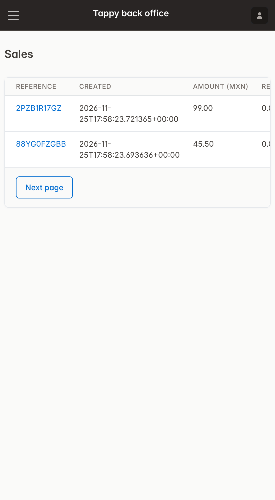
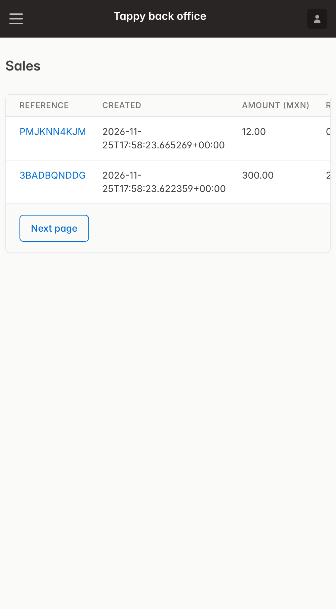
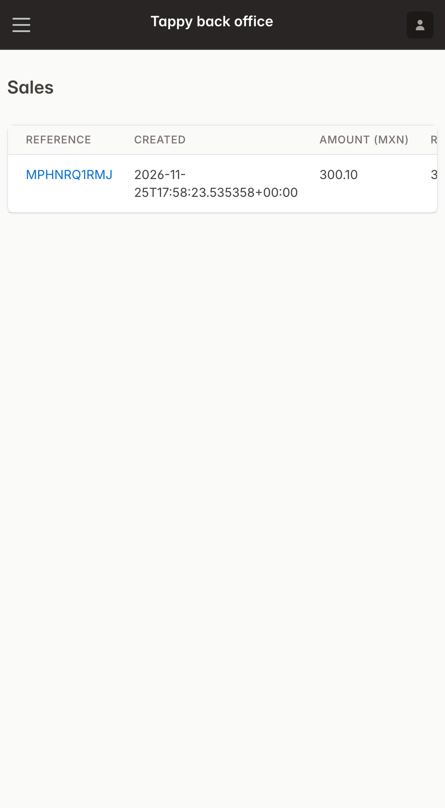
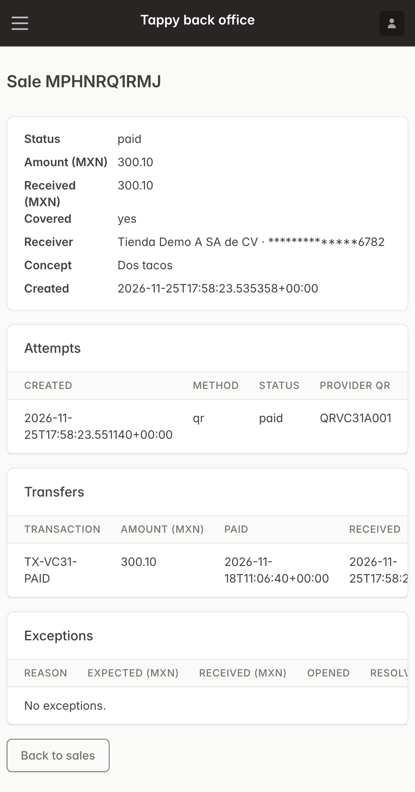
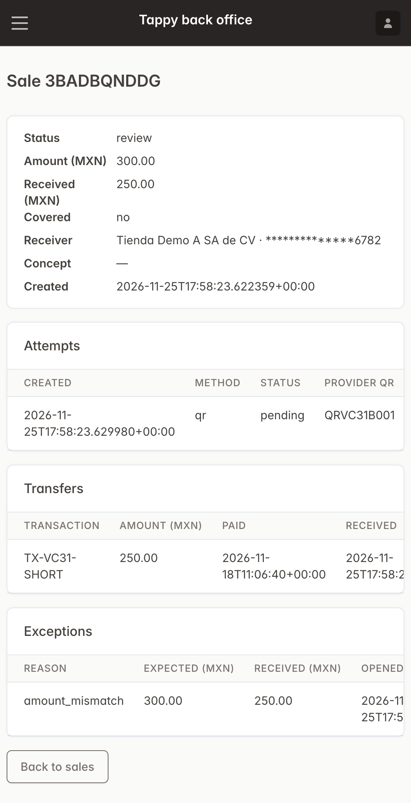
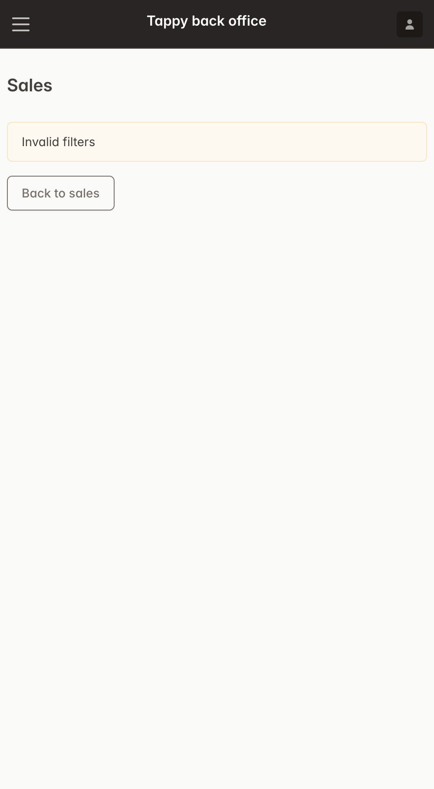

# Evidencia — B31 Inspeccionar cobros desde back office

Ticket: [#39](https://github.com/luisjrez/Tappy/issues/39) · Historia: [H6 #6](https://github.com/luisjrez/Tappy/issues/6) · Protocolo: [TICKET_QUALITY_PROTOCOL](../planning/TICKET_QUALITY_PROTOCOL.md) · Manifiesto: [B31-backoffice-sales.toml](B31-backoffice-sales.toml)

> Verificado con datos sintéticos, un pey falso local y el panel real en el navegador. **No hubo pagos reales.** El panel es de consulta: ningún administrador puede editar ni borrar dinero, ni marcar un cobro como recibido.

## Revisiones y escenario

- **Trazabilidad:** B31-UC01–UC03, B31-AC01–AC03 y B31-VC01.
- **Modalidad: resultado inicial (panel nuevo).** Las vistas `/admin/sales` y `/admin/sales/{id}` son nuevas; hay capturas abajo. La API no cambia de contrato. `GET /sales` y el panel comparten ahora `HistoryParams.to_query()`.
- **Base y revisiones:**
  - Base: rama B30 `3def62e` ([PR #86](https://github.com/luisjrez/Tappy/pull/86)), stack #68.
  - Candidato: `03664ce`.
  - Notas de la review: `aa4f039`, que es la revisión final. Las capturas se volvieron a tomar sobre ella.
- **Entorno:** macOS, Colima + Compose (Postgres 18), Python 3.14.8 y Chrome (DevTools). Fecha: 2026-11-25 (UTC). Ejecutor: sesión local de desarrollo del autor del PR.

## Diseño

### Vistas de consulta (`tappy.backoffice.sales.SalesView`)

Usan los mismos servicios autorizados que la API.

**Lista.** `sale_history`, con paginación keyset y el mismo alcance; un administrador ve todos los comercios.
- Filtros por URL: `status`, `merchant_id`, `created_from`, `created_to`, `limit` ≤ 50.
- Un enlace *Next page* lleva el cursor y conserva los filtros, hasta mostrar todas las ventas.

**Detalle.** `read_sale`, con estas secciones:
- **Venta:** estado, importe, recibido, si está cubierta, receptor enmascarado, concepto y fecha.
- **Intentos:** método, estado, `simulated`, QR, vencimiento, intento anterior y notas (fallo, comprobado sin pago, retirada).
- **Transferencias:** transacción, importe, hora de pago o «dated by reception», recepción y cuenta enmascarada.
- **Incidencias.**

Los importes se muestran en pesos a partir de centavos enteros (`pesos`), sin flotantes.

### Acceso

`AdminAuthProvider` deja la identidad del administrador en `request.state`, y `admin_identity()` la lee con comprobación de tipo.
- Los operadores y los visitantes anónimos vuelven al login.
- No hay ninguna ruta de escritura. Cualquier otro método (también `/receive` y `/delete` falsificados con un CSRF válido) responde `405` o `404`, y nada cambia.
- La única forma de la página es la de cerrar sesión.

### Errores

- Un filtro inválido o desconocido, o un cursor manipulado, responde `400` con una página de error.
- Un comercio o una venta desconocidos responden `404`.

La API usa `422` para los mismos casos. La diferencia está documentada.

### Alcance

- Igual que `GET /sales/{id}`, abrir un detalle aplica el vencimiento del servidor a los `pending` vencidos; nunca toca dinero ni recepción.
- **Fuera de alcance, registrado:** un formulario de filtros, el nombre del comercio en la lista, y los eventos y trabajos de conciliación. Las acciones sobre incidencias son de B32.

## Trazabilidad UC → AC → TC → test

Todos los tests están en `tests/backoffice/test_sales_panel.py`.

| UC | AC | TC | Test real | Resultado |
| --- | --- | --- | --- | --- |
| B31-UC01 | B31-AC01 | B31-TC01 | `test_the_admin_sees_sales_with_attempts_transfers_and_amounts` (fila, referencia, 300.10, `paid`; el detalle muestra transacción, estado y cuenta enmascarada, sin la CLABE completa) | PASS |
| B31-UC02 | B31-AC02 | B31-TC02 | `test_operators_cannot_open_the_sales_panel`; `test_the_panel_offers_no_way_to_change_money_or_force_a_reception[post\|put\|patch\|delete]` (CSRF válido, `405`/`404`, venta `open` con el mismo importe y 0 transferencias, solo el formulario de cierre de sesión) | PASS |
| B31-UC03 | B31-AC03 | B31-TC03 | `test_malformed_panel_filters_are_client_errors` (estado, `limit` 0 y 51, cursor y `merchant_id` → `400`); `test_an_unknown_sale_or_merchant_is_not_found_in_the_panel`; `test_panel_pages_recover_every_sale_without_hidden_truncation` (páginas de 2 hasta recorrer las 5 ventas, sin repetir) | PASS |

## TDD

**Red:** los tests se escribieron antes del código. Fallan 11 de 13. Los 2 que pasaban ya eran ciertos sin la vista: la redirección del operador y el `404` de una ruta inexistente. Se conservan como caracterización.

```
FAILED tests/backoffice/test_sales_panel.py::test_the_admin_sees_sales_with_attempts_transfers_and_amounts
FAILED tests/backoffice/test_sales_panel.py::test_the_panel_offers_no_way_to_change_money_or_force_a_reception[post]
FAILED tests/backoffice/test_sales_panel.py::test_the_panel_offers_no_way_to_change_money_or_force_a_reception[put]
FAILED tests/backoffice/test_sales_panel.py::test_the_panel_offers_no_way_to_change_money_or_force_a_reception[patch]
FAILED tests/backoffice/test_sales_panel.py::test_the_panel_offers_no_way_to_change_money_or_force_a_reception[delete]
FAILED tests/backoffice/test_sales_panel.py::test_malformed_panel_filters_are_client_errors[status=cancelled]
FAILED tests/backoffice/test_sales_panel.py::test_malformed_panel_filters_are_client_errors[limit=0]
FAILED tests/backoffice/test_sales_panel.py::test_malformed_panel_filters_are_client_errors[limit=51]
FAILED tests/backoffice/test_sales_panel.py::test_malformed_panel_filters_are_client_errors[cursor=manipulated]
FAILED tests/backoffice/test_sales_panel.py::test_malformed_panel_filters_are_client_errors[merchant_id=not-a-uuid]
FAILED tests/backoffice/test_sales_panel.py::test_panel_pages_recover_every_sale_without_hidden_truncation
11 failed, 2 passed in 6.77s
tests/backoffice/test_sales_panel.py::test_operators_cannot_open_the_sales_panel
tests/backoffice/test_sales_panel.py::test_an_unknown_sale_or_merchant_is_not_found_in_the_panel
```

Las 2 últimas líneas son los tests que ya pasaban antes de la implementación.

| Comportamiento | Red | Green |
| --- | --- | --- |
| Lista, detalle y errores | Ver arriba | `SalesView`, plantillas y `admin_identity` |
| Mutaciones sin protección CSRF | El primer test daba `403` (CSRF) en lugar de probar la ausencia de rutas. Se corrigió el test para enviar un CSRF válido: ahora da `405`/`404` | Solo rutas GET |
| Mutaciones de código | Sin el enlace *Next page*: falla el recorrido completo. Errores con `200`: fallan los 4 casos de filtro | — |

## Aplicabilidad por superficie

| Superficie | Aplica | Justificación |
| --- | --- | --- |
| Panel | Sí | Vistas nuevas; capturas abajo |
| API | No cambia | Solo comparte `HistoryParams.to_query()` |
| Comandos | No aplica | Sin comandos |

## B31-VC01 — Resultado inicial del panel de cobros

Proceso real `python -m tappy` con `TAPPY_PAYMENT_PROVIDER=pey`, un pey falso local y `TAPPY_ADMIN_SECURE_COOKIES=false` (HTTP local). Hay 5 ventas sintéticas:

- una pagada de 300.10 mediante un webhook firmado;
- una de 300.00 con un pago corto de 250.00, en revisión y con `amount_mismatch`;
- tres pendientes, de 12.00, 45.50 y 99.00.

El administrador inició sesión en el navegador (Chrome DevTools) sobre la revisión `aa4f039`.

| Vista | Captura | Qué se ve |
| --- | --- | --- |
| Página 1 (`limit=2`) |  | Las 2 ventas más recientes (99.00 y 45.50, `open`) y *Next page* |
| Página 2 |  | 12.00 `open` y 300.00 `review` con 250.00 recibidos; *Next page* |
| Página 3 |  | 300.10 `paid` y cubierta; ya no hay *Next page*. Las 5 ventas aparecen una vez |
| Detalle pagado |  | Venta, intento `paid` con su QR, transferencia `TX-VC31-PAID` 300.10 con la cuenta enmascarada, sin incidencias |
| Detalle en revisión |  | Intento `pending`, transferencia de 250.00 e incidencia `amount_mismatch` 300.00/250.00 abierta |
| Filtro inválido |  | `status=cancelled` → `400` «Invalid filters» |

Sondas HTTP sin sesión sobre el mismo proceso:

```
GET /admin/sales sin sesión → 303 http://127.0.0.1:8000/admin/login?next=http%3A%2F%2F127.0.0.1%3A8000%2Fadmin%2Fsales
DELETE /admin/sales/1c13a166-6c06-4dce-8bdd-b4a8b5e9ad49 sin sesión → 403
```

El `403` del DELETE sin sesión viene de la protección CSRF. Con sesión y CSRF válidos, los tests muestran `405`/`404`. Los datos se eliminaron al terminar. Estado VC01: **PASS**.

## Checks

`uv run python -m quality.check` sobre `aa4f039`, con `.env` exportado: PASS en todos los pasos.

- format, lint y types (mypy strict).
- hygiene.
- migrations: sin migraciones nuevas.
- tests: 548 passed, con Postgres real aislado.
- api: 16 contratos sin diferencias.
- evidence: B01–B30 APPROVED.

## Supresiones

Sin supresiones nuevas.

## Umbral

AC PASS / AC aplicables = 3/3 = **100%**.

## Review Standards/Spec

| Ronda | Revisión | Standards | Spec | Hallazgos |
| --- | --- | --- | --- | --- |
| 1 | `03664ce` + `d84b58d` | APPROVE | APPROVE | Ver detalle debajo de la tabla |

Detalle de la ronda 1. Ninguno de los dos revisores encontró violaciones ni defectos.

Aplicado en `aa4f039`:

- `HistoryParams.to_query()` compartido por la API y el panel;
- accesor tipado `admin_identity`;
- plantilla `sales_problem.html`;
- notas de intento (fallo, comprobado sin pago, retirada) en el detalle;
- README: el detalle aplica el vencimiento, los filtros van por URL y la lista no muestra el comercio.

Registrado:

- formulario de filtros, nombre del comercio, y eventos y trabajos de conciliación en el panel;
- `pesos` con importes negativos, que no existen.

Hallazgos pendientes: 0.
