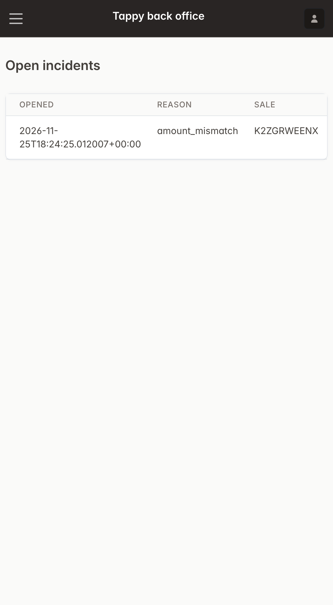
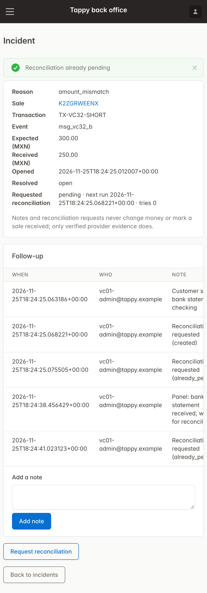
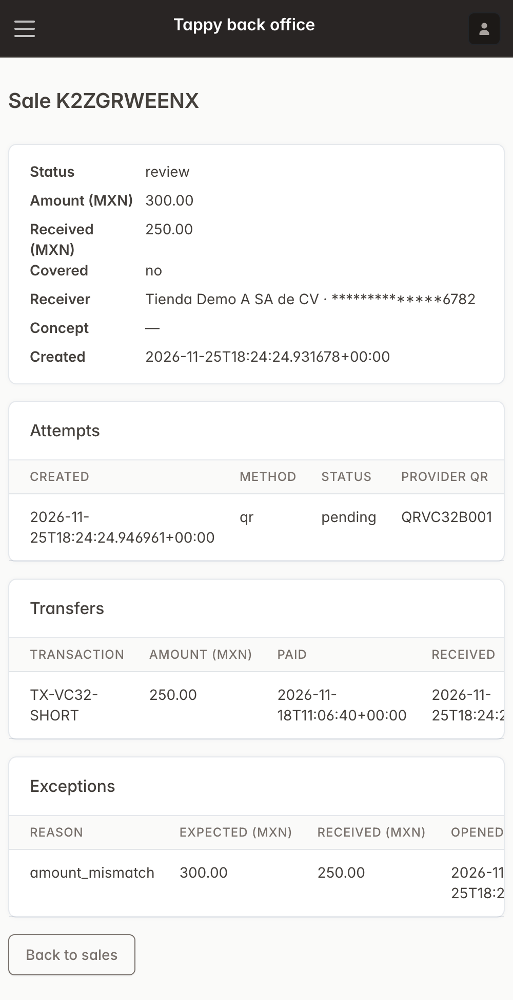

# Evidencia — B32 Revisar incidencias desde back office

Ticket: [#40](https://github.com/luisjrez/Tappy/issues/40) · Historia: [H6 #6](https://github.com/luisjrez/Tappy/issues/6) · Protocolo: [TICKET_QUALITY_PROTOCOL](../planning/TICKET_QUALITY_PROTOCOL.md) · Manifiesto: [B32-exception-review.toml](B32-exception-review.toml)

> Verificado con datos sintéticos, un pey falso local y el panel real en el navegador. **No hubo pagos reales.** Ninguna nota ni solicitud cambia dinero, resuelve una incidencia o marca un cobro como recibido. Solo lo hace la evidencia verificada del proveedor.

## Revisiones y escenario

- **Trazabilidad:** B32-UC01–UC03, B32-AC01–AC03 y B32-VC01. La superficie es la API y el panel.
- **Modalidad:** antes/después en la API (antes las rutas no existían, `404`) y resultado inicial en el panel, con capturas.
- **Cambios esperados en tests anteriores:** el inventario de rutas POST, que es un test de seguridad, añade las dos rutas de administración.
- **Base y revisiones:**
  - Base: rama B31 `0c1da86` ([PR #87](https://github.com/luisjrez/Tappy/pull/87)), stack #68.
  - Candidato: `3e4323e`.
  - Correcciones de la review: `9c9d6d1`, revisión final; la VC01 de la API se repitió sobre ella.
  - Las capturas del panel se tomaron sobre `3e4323e`. `9c9d6d1` no cambia el panel, solo la elección del intento y el rechazo de intentos pagados, y en este escenario se elige el mismo intento.
- **Entorno:** macOS, Colima + Compose (Postgres 18), Python 3.14.8 y Chrome (DevTools). Fecha: 2026-11-25 (UTC). Ejecutor: sesión local de desarrollo del autor del PR.

## Diseño

### Casos de uso compartidos (`tappy.sales.exception_review`)

La API y el panel usan los mismos casos de uso. Ninguno da acceso CRUD al registro financiero.

- `add_note`: nota de 1 a 1000 caracteres en `exception_notes`, con autor y hora (migración `0023`). Es la auditoría del seguimiento.
- `request_reconciliation`: encola un trabajo `review_requested` del ejecutor de B23 (`run-jobs`) para el intento correcto.
  - **Intento elegido:** primero el que tiene el QR guardado en la incidencia; si no, el de su transferencia dentro de la misma venta; si no, el último intento con QR de la venta.
  - **Intento ya pagado:** `409`, porque no queda nada que consultar. Esto cubre el caso típico de una doble recepción.
  - **Un trabajo lógico por intento:**
    - si ya está pendiente, devuelve `already_pending`;
    - si terminó o se agotó, se vuelve a armar (`rearmed`, intentos a 0): es la vía explícita del administrador para reintentar más allá de `TAPPY_JOB_MAX_TRIES`;
    - si no existía, `created`.
  - Cada solicitud queda registrada como nota.
- `read_exception`: devuelve la incidencia, sus notas y el trabajo pedido.
- **Incidencia sin venta (`unassociated`):** solo admite notas; pedir conciliación da `409`.

### API, solo para administradores (`CurrentAdmin`)

- `GET /exceptions/{id}`
- `POST /exceptions/{id}/notes` → `201`
- `POST /exceptions/{id}/reconciliation` → `202`

Un operador recibe `403` y una petición anónima `401`. No hay un listado en la API: la lista está en el panel y en el comando `exceptions`.

### Panel

- `/admin/exceptions` lista las incidencias abiertas.
- `/admin/exceptions/{id}` muestra la incidencia, el enlace a la venta, el seguimiento, el trabajo pedido y dos formularios con CSRF.
- Un CSRF ausente o falsificado da `403` y no escribe nada.
- Los operadores vuelven al login.

### Comportamiento esperado del trabajo

Con un `amount_mismatch`, la consulta suele volver a encontrar solo la transferencia corta, así que el trabajo termina `exhausted` salvo que aparezca evidencia nueva. Eso es correcto: no se inventa una recepción.

## Trazabilidad UC → AC → TC → test

| UC | AC | TC | Test real | Resultado |
| --- | --- | --- | --- | --- |
| B32-UC01 | B32-AC01 | B32-TC01 | `tests/sales/test_exception_review.py::test_an_admin_notes_an_incident_and_requests_a_recoverable_reconciliation` (nota con autor, solicitud `created`, notas auditadas, dinero igual); `…::test_the_requested_reconciliation_is_picked_up_by_the_job_runner` (`run-jobs` lo reclama, intento 1, dinero igual); `…::test_the_reconciliation_targets_the_qr_of_the_incident_not_the_latest_attempt`; `…::test_a_paid_attempt_has_nothing_left_to_reconcile`; `…::test_an_unassociated_incident_can_be_noted_but_not_reconciled`; `tests/backoffice/test_exceptions_panel.py::test_the_admin_notes_and_requests_reconciliation_from_the_panel`; `…::test_an_empty_note_is_refused_with_a_message`; `test_exception_review.py::test_invalid_notes_are_rejected` | PASS |
| B32-UC02 | B32-AC02 | B32-TC02 | `test_exception_review.py::test_operators_and_anonymous_callers_cannot_review_incidents` (`403`/`401`, sin notas ni trabajos); `test_exceptions_panel.py::test_without_a_valid_csrf_token_nothing_is_written`; `…::test_operators_cannot_review_incidents_in_the_panel` (GET y POST de operador: sin nota ni trabajo) | PASS |
| B32-UC03 | B32-AC03 | B32-TC03 | `test_exception_review.py::test_repeating_the_request_keeps_one_logical_job_and_the_evidence_intact` (`created`, `already_pending`, `rearmed`; un solo trabajo; mismo dinero; mismo digest del evento original); `test_exceptions_panel.py::test_a_second_request_from_the_panel_keeps_one_job` | PASS |

## TDD

**Red:** los tests se escribieron antes del código.

- **API:** fallan los 7.
- **Panel:** fallan 3 de 5. Los 2 que pasaban ya eran ciertos antes: el `403` por CSRF del panel y la redirección del operador. Se conservan como caracterización.

```
FAILED tests/sales/test_exception_review.py::test_an_admin_notes_an_incident_and_requests_a_recoverable_reconciliation
FAILED tests/sales/test_exception_review.py::test_repeating_the_request_keeps_one_logical_job_and_the_evidence_intact
FAILED tests/sales/test_exception_review.py::test_operators_and_anonymous_callers_cannot_review_incidents
FAILED tests/sales/test_exception_review.py::test_invalid_notes_are_rejected[]
FAILED tests/sales/test_exception_review.py::test_invalid_notes_are_rejected[   ]
FAILED tests/sales/test_exception_review.py::test_invalid_notes_are_rejected[text2]
FAILED tests/sales/test_exception_review.py::test_an_unassociated_incident_can_be_noted_but_not_reconciled
7 failed in 3.56s
FAILED tests/backoffice/test_exceptions_panel.py::test_the_admin_notes_and_requests_reconciliation_from_the_panel
FAILED tests/backoffice/test_exceptions_panel.py::test_a_second_request_from_the_panel_keeps_one_job
FAILED tests/backoffice/test_exceptions_panel.py::test_an_empty_note_is_refused_with_a_message
3 failed, 2 passed in 3.24s
```

| Comportamiento | Red | Green |
| --- | --- | --- |
| Notas, solicitud, API y panel | Ver arriba | `exception_review`, `0023`, `exceptions_router`, `ExceptionsView` |
| Intento correcto e intento pagado (review) | `…targets_the_qr_of_the_incident…` falla (elegía el último intento) y `…paid_attempt…` da `assert 202 == 409` | Elección por QR, por transferencia y por último intento; `AttemptAlreadyPaidError` |
| Mutaciones | Sin `already_pending`: fallan 2. Sin registrar la solicitud como nota: fallan 3 | — |

## Aplicabilidad por superficie

| Superficie | Aplica | Justificación |
| --- | --- | --- |
| API | Sí | Tres rutas de administración nuevas |
| Panel | Sí | Vistas de incidencias nuevas; capturas abajo |
| Comandos | Sí, sin cambios | `run-jobs` procesa el trabajo pedido |

## B32-VC01 — API antes/después y panel

Proceso real `python -m tappy` con `TAPPY_PAYMENT_PROVIDER=pey`, un pey falso local y `TAPPY_ADMIN_SECURE_COOKIES=false`. La venta sintética es de 300.00 con un pago corto de 250.00, que deja una incidencia `amount_mismatch`. En la salida se oculta el correo del autor.

### API — antes (B31 `0c1da86`)

- Estado inicial → `{"sale": "review", "transfers": [1, 25000], "open_incidents": 1, "jobs": []}`
- Admin: GET de la incidencia → 404 `{"detail": "Not Found"}`
- Admin: nota → 404 `{"detail": "Not Found"}`
- Admin: solicitar conciliación → 404 `{"detail": "Not Found"}`
- Admin: solicitar conciliación otra vez → 404 `{"detail": "Not Found"}`
- Operador: solicitar conciliación → 404 `{"detail": "Not Found"}`
- Operador: nota → 404 `{"detail": "Not Found"}`
- Estado final → `{"sale": "review", "transfers": [1, 25000], "open_incidents": 1, "jobs": []}`

### API — después (revisión final `9c9d6d1`)

- Estado inicial → `{"sale": "review", "transfers": [1, 25000], "open_incidents": 1, "jobs": []}`
- Admin: GET de la incidencia → 200 `{"reason": "amount_mismatch", "notes": [], "reconciliation": null}`
- Admin: nota → 201 `{"text": "Customer sent a bank statement; checking", "author": "<administrador>"}`
- Admin: solicitar conciliación → 202 `{"outcome": "created", "job": {"status": "pending", "tries": 0}}`
- Admin: solicitar conciliación otra vez → 202 `{"outcome": "already_pending", "job": {"status": "pending", "tries": 0}}`
- Operador: solicitar conciliación → 403 `{"detail": "Administrator role required"}`
- Operador: nota → 403 `{"detail": "Administrator role required"}`
- Estado final → `{"sale": "review", "transfers": [1, 25000], "open_incidents": 1, "jobs": [["review_requested", "pending", 0]]}`

### Panel (`3e4323e`, mismo código de panel que la revisión final)

| Vista | Captura | Qué se ve |
| --- | --- | --- |
| Incidencias abiertas |  | La incidencia `amount_mismatch` (300.00 esperado, 250.00 recibido) con enlace *Review* |
| Detalle tras nota y doble solicitud |  | Seguimiento con autor y hora: la nota por API, `created`, `already_pending`, la nota del panel y la nueva solicitud `already_pending`; un trabajo `pending` |
| Venta intacta |  | Sigue `review`, 250.00 recibidos y la incidencia abierta: nada se acreditó a mano |

Sondas sin CSRF y estado final sobre el mismo proceso:

```
POST /admin/exceptions/e3a7167f-0c77-440b-8f7d-fbd1ea5bda5b/notes sin CSRF → 403
POST /admin/exceptions/e3a7167f-0c77-440b-8f7d-fbd1ea5bda5b/reconciliation sin CSRF → 403
Estado tras el panel → {'sale': 'review', 'transfers': [1, 25000], 'open_incidents': 1, 'notes': 5, 'jobs': [['review_requested', 'pending', 0]]}
```

**Validación:**

- **TC01:** la nota queda auditada con autor y hora, y el trabajo `review_requested` queda pendiente y recuperable por `run-jobs`.
- **TC02:** el operador recibe `403` en la API y vuelve al login en el panel. Sin CSRF, el panel da `403` y no escribe nada.
- **TC03:** una segunda solicitud da `already_pending` y sigue habiendo un solo trabajo. El dinero (1 transferencia de 250.00), el estado `review` y la incidencia abierta no cambian.

Los datos se eliminaron al terminar. Estado VC01: **PASS**.

## Checks

`uv run python -m quality.check` sobre `9c9d6d1`, con `.env` exportado: PASS en todos los pasos.

- format, lint, types (mypy strict) y hygiene;
- migrations: upgrade/downgrade/upgrade de `0023` + `alembic check`;
- tests: 563 passed, Postgres real aislado;
- api: 16 contratos sin diferencias;
- evidence: B01–B31 APPROVED.

## Supresiones

Sin supresiones nuevas.

## Umbral

AC PASS / AC aplicables = 3/3 = **100%**.

## Review Standards/Spec

| Ronda | Revisión | Standards | Spec | Hallazgos |
| --- | --- | --- | --- | --- |
| 1 | `3e4323e` | APPROVE | REQUEST_CHANGES | Ver detalle debajo de la tabla |

Detalle de la ronda 1. Las correcciones se aplicaron en `9c9d6d1` con Red/Green.

**Spec:**

- Faltaba demostrar que el trabajo es recuperable: ahora un test lo procesa con `run-jobs`.
- Se elegía el último intento en lugar del QR de la incidencia.
- Un intento ya pagado generaba un trabajo inútil: ahora da `409`.
- Faltaba un test de POST de operador en el panel.

**Standards:**

- El re-armado del trabajo se movió a `jobs.rearm_job`.
- El detalle del panel captura solo `ExceptionNotFoundError`.
- El handler se renombró a `create_note`.

**Registrado:**

- Falta un listado de incidencias en la API.
- La lógica de render de `SalesView` y `ExceptionsView` está duplicada; extraer una base cuando haya una tercera vista.
- Un trabajo `review_requested` puede coincidir con uno automático de B23: la consulta se repite, pero es idempotente.

Hallazgos pendientes: se actualiza tras la ronda 2.
