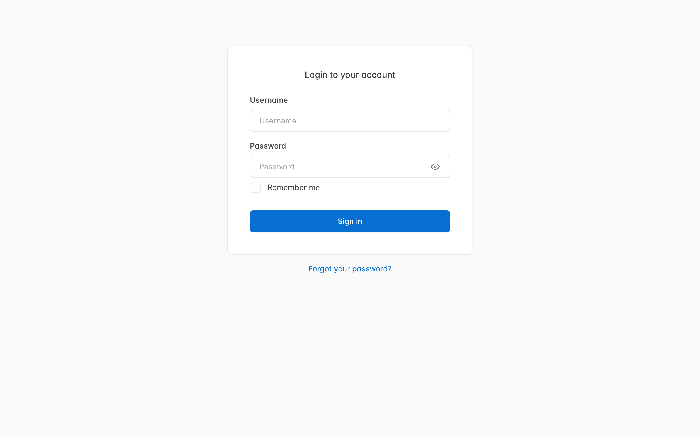
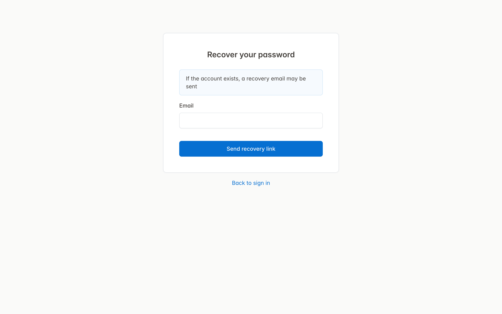

# Evidencia — B41 Solicitar recuperación de contraseña por correo

Ticket: [#49](https://github.com/luisjrez/Tappy/issues/49) · Historia: [H2 #2](https://github.com/luisjrez/Tappy/issues/2) · Protocolo: [TICKET_QUALITY_PROTOCOL](../planning/TICKET_QUALITY_PROTOCOL.md) · Manifiesto: [B41-password-recovery-request.toml](B41-password-recovery-request.toml)

> **Estado: BLOCKED por B41-TC06.** La entrega real a un buzón controlado requiere proveedor SMTP y remitente autorizados que aún no existen. El resto del ticket está implementado y verificado con Mailpit (SMTP de prueba). Por decisión del usuario (2026-11-20), B41/B42 viven en un stack lateral con base B08 para no bloquear el stack principal.

## Revisiones y escenario

- Ticket, UC/AC/TC y comprobación: B41-UC01–UC05, B41-AC01–AC05, B41-TC01–TC06, B41-VC01.
- Modalidad: **resultado inicial** (endpoint, worker, formulario del panel y plantilla de login nuevos). La vista de login de B07 cambia solo por el enlace «Forgot your password?» (cambio esperado). Contratos existentes sin diferencias; nuevo `password-reset-request` (202) aprobado en `f02a52a` (mensaje «may be sent»).
- Base: rama B08 `8610294` (PR #59). Revisiones: candidato `f30a5a5` → rediseño `f02a52a` → código final `cbe0679` (menores de la re-revisión). Tests y checks corresponden a `cbe0679`; el VC01 se capturó sobre `f02a52a` y su comportamiento visible no cambió.
- Entorno: macOS, Colima + Compose (Postgres 18.6, Mailpit v1.33.0), Python 3.14.8, cryptography 50.0.2; Chrome (DevTools MCP), 1280×800. Fecha: 2026-11-20. Ejecutor: sesión local de desarrollo del autor del PR.
- Datos: identidades sintéticas `@tappy.example`; tokens redactados en esta página.

## Diseño

- Política (configurable): vida del token `TAPPY_PASSWORD_RESET_TTL_SECONDS` (1800), límites por correo (3) y por origen (10) en una ventana de 3600 s, origen del enlace `TAPPY_PUBLIC_BASE_URL` (esquema+host, sin ruta).
- Mismo trabajo para toda cuenta: `submit_recovery` (en la petición) solo valida longitud/formato del correo, registra intentos persistentes con digests **HMAC** (clave derivada del secreto) por correo y por origen, y si ambos están dentro del límite encola un `RecoveryJob` con el correo **cifrado**. No consulta la identidad: la respuesta (`202` «If the account exists, a recovery email may be sent») y su trabajo son idénticos para cuenta activa, inactiva o inexistente.
- Worker `python -m tappy.notifications deliver`: (1) `process_recovery_jobs` toma trabajos con `FOR UPDATE SKIP LOCKED`, purga el correo cifrado y, solo si la identidad existe y está activa, crea `password_reset_requests` (digest SHA-256 del token, `expires_at`) y encola el correo; (2) `deliver_due` reclama **cada correo en su propia transacción** (suma el intento y programa el siguiente antes de enviar, así un fallo inesperado nunca deja reintentos infinitos ni revierte envíos ya hechos), envía fuera de la transacción y registra el resultado (`DeliveryOutcome`). `SMTPException`/`OSError` (incluida la respuesta ambigua tras DATA) → reintento con backoff exponencial hasta `TAPPY_DELIVERY_MAX_ATTEMPTS`; cuerpo indescifrable → `failed` sin bloquear la cola. Entrega «al menos una vez». Cuerpos cifrados (Fernet) y purgados al enviar o fallar.
- Enlace `PUBLIC_BASE_URL/password-reset#token=…`: el token va en el fragmento y nunca llega a los logs del servidor; la página que lo consume es B42.
- Panel: ruta pública `/admin/forgot-password` registrada por el `AuthProvider` (en `allow_routes`), con CSRF, enlazada desde el login; mismo caso de uso y mensaje; valor del formulario aceptado solo como texto.
- `RecoveryService` (política + sellador) se crea una vez en `create_app` y lo comparten API y panel; `client_origin` común.
- Fuera de alcance (ticket): consumo del token y cambio de contraseña (B42); sin alta pública, invitaciones ni cambio de correo. El destinatario es siempre el correo registrado de la identidad, nunca el del cuerpo de la petición.

## Trazabilidad UC → AC → TC → test

| UC | AC | TC | Prueba real | Resultado |
| --- | --- | --- | --- | --- |
| B41-UC01 | B41-AC01 | B41-TC01 | `test_active_identity_receives_link_with_configured_origin` (SMTP real a Mailpit: destinatario, enlace con origen configurado, token ausente de la respuesta); `test_deliver_command_sends_pending_email`; formulario del panel: `test_login_page_links_to_public_recovery_form`, `test_recovery_form_answers_generically_and_queues_only_for_real_accounts`, `test_recovery_form_requires_csrf` | PASS |
| B41-UC01 | B41-AC01 | B41-TC06 | Entrega real a buzón controlado con remitente configurado | **BLOCKED** (sin proveedor) |
| B41-UC02 | B41-AC02 | B41-TC02 | `test_unknown_or_inactive_accounts_get_the_same_answer_and_nothing_else` (mismo 202 y cuerpo; tras el worker, sin correo ni reset; la inactiva sigue inactiva); `test_request_path_does_identical_work_for_every_account` (activa/inactiva/inexistente: un trabajo, cero correos y resets en la petición); `test_response_time_does_not_reveal_existing_accounts` (medianas de 15 peticiones, diferencia < 20 ms) | PASS |
| B41-UC03 | B41-AC03 | B41-TC03 | `test_limits_persist_across_processes_and_never_touch_credentials` (5 solicitudes en un proceso + 1 contra un servidor real en otro proceso del SO → solo 3 trabajos; login intacto); `test_origin_limit_applies_across_different_accounts` | PASS |
| B41-UC04 | B41-AC04 | B41-TC04 | `test_provider_failure_is_retried_after_restart_without_changing_credentials` (fallo 451 → reintento programado → nuevo proceso entrega; login intacto); `test_delivery_gives_up_after_bounded_attempts`; `test_deliver_command_requires_known_subcommand`; `test_ambiguous_provider_response_is_retried_not_reported_as_delivered`; `test_undecryptable_email_fails_alone_without_blocking_the_queue` | PASS |
| B41-UC05 | B41-AC05 | B41-TC05 | `test_link_origin_ignores_host_headers_and_raw_token_is_never_stored` (`Host`/`X-Forwarded-Host` manipulados; digest = SHA-256 del token; trabajo cifrado sin el correo en claro; cuerpo purgado tras enviar; token fuera de respuesta y logs) | PASS |

## TDD

| Comportamiento | Red | Green |
| --- | --- | --- |
| Correo entregado con enlace configurado | Stub del worker: `not enough values to unpack (expected 1, got 0)` (Mailpit vacío) | Outbox, sellado, SMTP, caso de uso, endpoint, migración `0005` |
| Formulario del panel | 3 fallos (sin enlace en login, 404 en `/admin/password-reset`) | Ruta pública del `AuthProvider`, plantillas `login.html`/`password_reset.html` |
| Subcomando `deliver` explícito | `python -m tappy.notifications` sin subcomando salía 0 | `argparse` con subcomando obligatorio |
| Respuesta genérica, límites, reintento, origen, token | Sin Red propio (cubiertos por el Green de TC01). Mutaciones detectadas y revertidas: sin límites → fallan los 2 tests de TC03; cuentas inactivas reciben correo → falla TC02[inactive]; token bruto persistido → falla TC05; cuerpo no purgado → fallan TC04 y TC05; sin reintentos → fallan los 2 de TC04; cuerpo en claro → fallan 4 tests | — |
| Rediseño tras review (trabajos, entrega aislada, fragmento, mensaje, ruta del panel) | Tests actualizados primero: `15 failed, 5 passed` (sin `recovery_jobs`, enlace con `?token=`, mensaje «will be sent», ruta `/admin/password-reset`, cola bloqueada por un cuerpo indescifrable) | `RecoveryJob` + `process_recovery_jobs`, `claim_next`/`record` por correo, `#token=`, «may be sent», `/admin/forgot-password` |
| Mutaciones del rediseño | Worker emite reset para inactivas → falla TC02[inactive] (tras corregir el test para ejecutar el worker); correo del trabajo no purgado → falla TC04; error de descifrado propagado → falla `…undecryptable…`; trabajo solo para cuentas existentes → fallan `…identical_work…[None]` y el formulario con correo inexistente | — |

Hallazgo durante TDD: un test que marcaba `next_attempt_at = now()` en Postgres no quedaba vencido para el reloj del host; los tests lo fijan una hora atrás (el worker usa el reloj del proceso).

## B41-VC01 — Resultado inicial

API (proceso real sobre `f02a52a`, DB en `0005`):

```text
POST /auth/password-reset/request {"email":"vc01-admin@tappy.example"} → 202 {"detail":"If the account exists, a recovery email may be sent"}
POST /auth/password-reset/request {"email":"nadie@tappy.example"}      → 202 {"detail":"If the account exists, a recovery email may be sent"}
POST … con Host: evil.example                                          → 202
recovery_jobs antes del worker: 3 filas, sealed_email = gAAAAABrASYP… (cifrado), sin procesar
$ python -m tappy.notifications deliver → sent=2 retried=0 failed=0 (exit 0)
recovery_jobs después: 3 filas purgadas y procesadas (la del correo inexistente no generó nada)
outbound_emails: sent|1|cuerpo purgado (×2)
```

Correo recibido en Mailpit (token redactado; origen configurado aunque una solicitud llevara `Host: evil.example`):

```text
To: ['vc01-admin@tappy.example'] | Subject: Reset your Tappy password
We received a request to reset your Tappy password.

Open this link within the next 30 minutes:
http://127.0.0.1:8000/password-reset#token=<redactado>

If you did not ask for it, ignore this email; your password stays the same.
```

Panel:

| Vista | Captura | Comprobación |
| --- | --- | --- |
| Login con enlace (B07 modificado) |  | Único cambio respecto a B07: enlace «Forgot your password?» a `/admin/forgot-password` |
| Solicitud desde el panel con correo inexistente |  | Mismo mensaje genérico (`role=status`) que para una cuenta real |

Logs del servidor sin `token=` (0 coincidencias). Datos y buzón limpiados al terminar. Estado VC01: **PASS** (resultado inicial; la entrega real es TC06, BLOCKED).

## Checks sobre `cbe0679`

`uv run python -m quality.check`: format, lint, types, hygiene, migrations (`0005` sin drift), tests (`164 passed`), api (9 contratos sin diferencias) en PASS; `evidence`: B01–B08 APPROVED, B41 BLOCKED (80 %, TC06 + review).

## Supresiones

`tests/identity/test_password_recovery.py` → `S310` (API HTTP local de Mailpit) y `S603` (ejecuta el worker como subproceso).

## Umbral

AC PASS / AC aplicables = 4/5 = **80%** (B41-AC01 BLOCKED por TC06). No alcanza el 97% y AC01 es obligatorio: **el gate de evidencia bloquea B41** hasta ejecutar TC06 con un proveedor real.

## Review Standards/Spec

Ronda 1 sobre `f30a5a5`, sin violaciones duras; correcciones en `f02a52a`.

| Eje | Hallazgo | Resolución |
| --- | --- | --- |
| Standards / Spec | Enumeración por tiempo: cuentas activas hacían más trabajo en la petición; tiempo sin medir | Petición idéntica para toda cuenta (trabajo cifrado); el worker resuelve la identidad; test de trabajo idéntico y de medianas de tiempo |
| Spec | Reintentos no acotados: un error no previsto revertía el lote (reenvíos) y bloqueaba la cola | Reclamo por correo en transacción propia con intento contado antes de enviar; indescifrable → `failed` aislado (test) |
| Spec | «Respuesta ambigua» sin test | `SMTPServerDisconnected` tras DATA → reintento, nunca «entregado» (test); entrega al menos una vez documentada |
| Spec | «Otro proceso» aproximado con dos apps | Segunda solicitud contra un servidor real en otro proceso del SO |
| Spec | Mensaje prometía entrega | «may be sent»; base de contrato reaprobada |
| Spec | Enlace a una ruta inexistente | Ruta `/password-reset` reservada para la página de B42; documentado |
| Spec | Red sustituido por mutaciones | Rediseño con Red previo (15 fallos); mutaciones registradas además |
| Standards | Token en query string (logs al servir la página) | Token en el fragmento `#token=` |
| Standards | `origin` duplicado | `client_origin` en `platform.requests` |
| Standards | `attempt()` con `None` = reintento | `DeliveryOutcome` (`sent`/`retry`/`failed`) |
| Standards | Tres nombres para un concepto; `/password-reset` con dos significados | `RecoverySubmission`; panel en `/admin/forgot-password`; `/password-reset` solo para B42 |
| Standards | Columnas `consumed_at`/`invalidated_at` sin uso | Retiradas (las añadirá B42) |
| Standards | Data clumps en la entrega | `DeliveryContext` |
| Standards | `RecoveryService` por petición | Una instancia en `create_app`, compartida por API y panel |
| Standards | Digests de límites sin clave; formulario sin límite de longitud y aceptaba archivos | HMAC con clave derivada; límite 254 y solo texto |
| Standards | `RecoveryService.submit` como Middle Man | Se conserva: agrupa política y sellador para API, panel y worker |

Re-revisión sobre `f02a52a`: sin hallazgos bloqueantes en ambos ejes (sin señal de enumeración; entrega por correo aislada; fragmento; HMAC; sin correos en claro fuera de `identities` y destinatario del outbox). Menores aplicados en `cbe0679` con Red/Green: un correo que ya agotó intentos (caídas repetidas a mitad de envío) se marca `failed` sin reenviar (`test_exhausted_email_is_not_sent_again_after_repeated_crashes`); cada trabajo de recuperación corre en su savepoint y un error de DB en uno no frena al resto; el worker borra intentos fuera de la ventana (`test_worker_discards_attempts_outside_the_window`). Ambos ejes aprobados. **B41 sigue BLOCKED por TC06** (80 %).
