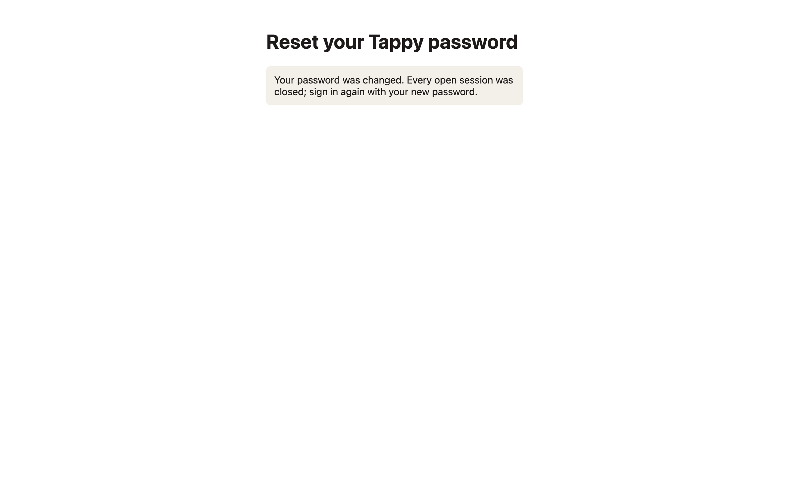

# Evidencia — B42 Restablecer contraseña y revocar sesiones anteriores

Ticket: [#50](https://github.com/luisjrez/Tappy/issues/50) · Historia: [H2 #2](https://github.com/luisjrez/Tappy/issues/2) · Protocolo: [TICKET_QUALITY_PROTOCOL](../planning/TICKET_QUALITY_PROTOCOL.md) · Manifiesto: [B42-password-reset.toml](B42-password-reset.toml)

> Stack lateral encima de B41 (#60). B42 no tiene casos externos propios: todos sus AC se verifican con Postgres y correo simulado/Mailpit. La rama hereda el manifiesto de B41, que sigue BLOCKED por su TC06; por eso el CI de esta rama también falla en `evidence` hasta desbloquear B41.

## Revisiones y escenario

- Ticket, UC/AC/TC y comprobación: B42-UC01–UC06, B42-AC01–AC06, B42-TC01–TC06, B42-VC01.
- Modalidad: **resultado inicial** (página `/password-reset` y `POST /auth/password-reset/confirm` nuevos). Contratos existentes sin diferencias; nuevo `password-reset-confirm-invalid` (400) aprobado en `d0f2b84`.
- Base: rama B41 (PR #60). Revisión evaluada: candidato `d0f2b84`.
- Entorno: macOS, Colima + Compose (Postgres 18.6, Mailpit v1.33.0), Python 3.14.8; Chrome (DevTools MCP), 1280×800. Fecha: 2026-11-20. Ejecutor: sesión local de desarrollo del autor del PR.
- Datos: identidad y frases sintéticas; tokens redactados.

## Diseño

- `tappy.identity.reset.confirm_password_reset` (caso de uso único para API y formulario), en una transacción:
  1. `pending_reset`: enlace por digest, sin consumir, sin invalidar y vigente, con `FOR UPDATE` (dos consumos concurrentes: el segundo espera y luego ya no cumple el filtro → «invalid or expired»).
  2. `active_owner`: la identidad del enlace, activa (`FOR NO KEY UPDATE`); el token es lo único que identifica al titular, el esquema rechaza campos extra (`role`, `email`, …).
  3. `hash_password` con la misma política de alta y bootstrap (NFKC, 12–128, lista de comunes); si falla, nada se consume.
  4. Cambia el hash, consume el enlace, invalida los demás enlaces pendientes, revoca todas las sesiones (API y panel comparten `access_sessions`) y encola el aviso «Your Tappy password was changed» (sin contraseña) en el outbox de B41.
- Migración `0006`: `consumed_at`, `invalidated_at` en `password_reset_requests`.
- API: `POST /auth/password-reset/confirm` → `204` (sin tokens: no hay login automático), `400` enlace inválido, `422` política o campos extra.
- Página pública `GET/POST /password-reset` (fuera del panel, plantilla propia): sin recursos de terceros, `Referrer-Policy: no-referrer`, `Cache-Control: no-store`, `nosniff`, CSP con nonce (`default-src 'none'`). El GET no recibe el token (va en el fragmento), así que no puede consumirlo; un script con nonce lo lee, lo quita de la barra (`history.replaceState`) y lo guarda en `sessionStorage` solo para reintentos tras un error; se borra al terminar con éxito. El formulario pide confirmación de la contraseña; los errores no repiten token ni contraseña.
- Sin CSRF en el formulario público: no hay sesión que suplantar; el token secreto es lo que autoriza y solo cambia la contraseña de su titular.
- Fuera de alcance (ticket): pantallas móviles, cambio de correo, recuperación de cuentas comprometidas, MFA.

## Trazabilidad UC → AC → TC → test

| UC | AC | TC | Test real | Resultado |
| --- | --- | --- | --- | --- |
| B42-UC01 | B42-AC01 | B42-TC01 | `test_valid_token_sets_new_password_without_signing_in` (204 sin tokens; nueva entra, anterior falla; misma referencia y rol); `test_form_changes_password_and_points_back_to_sign_in` | PASS |
| B42-UC02 | B42-AC02 | B42-TC02 | `test_invalid_links_never_change_the_password[expired, altered, reused]`; `test_concurrent_confirmations_change_the_password_once` (4 hilos: un 204, tres 400; gana una sola contraseña) | PASS |
| B42-UC03 | B42-AC03 | B42-TC03 | `test_deactivated_identity_is_not_reactivated_by_a_pending_link`; `test_extra_identity_fields_are_rejected_without_changes[role, email, user_id, reference]` | PASS |
| B42-UC04 | B42-AC04 | B42-TC04 | `test_reset_revokes_every_session_and_pending_link` (access y refresh previos → 401; enlace anterior pendiente → 400; cero sesiones activas) | PASS |
| B42-UC05 | B42-AC05 | B42-TC05 | `test_policy_violation_keeps_the_link_usable`; `test_failure_inside_the_transaction_leaves_everything_unchanged` (fallo inducido en el aviso: hash, consumo y sesiones intactos; el enlace sigue sirviendo); `test_form_errors_are_safe_and_change_nothing[mismatch, tampered]` | PASS |
| B42-UC06 | B42-AC06 | B42-TC06 | `test_opening_the_page_does_not_consume_the_link` (incluso con `?token=` en la URL); `test_reset_page_is_self_contained_and_never_leaks_the_link`; `test_change_notice_is_queued_without_password_and_its_failure_keeps_the_change` | PASS |

## TDD

| Comportamiento | Red | Green |
| --- | --- | --- |
| Confirmación por API | `assert 404 == 204` | `confirm_password_reset`, migración `0006`, endpoint |
| Página pública | 4 fallos (sin ruta, sin cabeceras, sin formulario) | `reset_page.py` + plantilla |
| Enlace de un solo uso | Retirando `consumed_at IS NULL`: fallan `…[reused]` y la concurrencia | Filtro restaurado |
| Vencimiento | Sin `expires_at > now`: falla `…[expired]` | Filtro restaurado |
| Concurrencia | Sin `FOR UPDATE`: falla `…concurrent…` | Bloqueo de fila |
| Cuenta desactivada | Sin chequeo de estado: falla `…not_reactivated…` | `active_owner` |
| Otros enlaces y sesiones | Sin invalidar enlaces / sin revocar sesiones: falla `…revokes_every_session…` | `invalidate_other_links`, `revoke_identity_sessions` |
| Política antes de consumir | Consumir y confirmar antes de validar: fallan 12 tests | Orden: política → cambios |

Los tests de TC02–TC06 pasaron a la primera porque el Green de TC01 implementó el caso de uso completo; el Red de cada comportamiento se observó retirándolo temporalmente (todas las mutaciones revertidas).

## B42-VC01 — Resultado inicial

Recorrido real (servidor `python -m tappy` con `TAPPY_PUBLIC_BASE_URL=http://127.0.0.1:8774`, enlace generado por el worker y leído de Mailpit):

```text
GET /password-reset → 200
referrer-policy: no-referrer
cache-control: no-store
x-content-type-options: nosniff
content-security-policy: default-src 'none'; script-src 'nonce-…'; style-src 'nonce-…'; form-action 'self'; base-uri 'none'; frame-ancestors 'none'
```

| Paso | Captura / resultado |
| --- | --- |
| Abrir `…/password-reset#token=<redactado>` |  La barra queda en `/password-reset`: el token ya no está en la URL |
| Confirmación distinta |  «Passwords do not match» (422); nada se consume |
| Contraseña válida |  «Your password was changed…»; sin sesión nueva |

```text
GET /auth/me con la sesión abierta antes del cambio → 401
POST /auth/login contraseña anterior               → 401 {"detail":"Invalid email or password"}
POST /auth/login contraseña nueva                  → 200
POST /auth/password-reset/confirm reutilizando     → 400 {"detail":"This link is invalid or has expired"}
$ python -m tappy.notifications deliver            → sent=1
Aviso en Mailpit: "Your Tappy password was changed" — no contiene la contraseña
Log de acceso: "GET /password-reset HTTP/1.1" (sin token); 0 coincidencias del token en el log
```

Datos de prueba y buzón limpiados al terminar. Estado VC01: **PASS** (resultado inicial).

## Checks

Pendiente de registrar sobre la revisión final.

## Supresiones

Sin supresiones nuevas.

## Umbral

AC PASS / AC aplicables = 6/6 = **100%** (B42 propio). El gate de la rama sigue fallando por el manifiesto heredado de B41 (BLOCKED por TC06).

## Review Standards/Spec

Pendiente.
