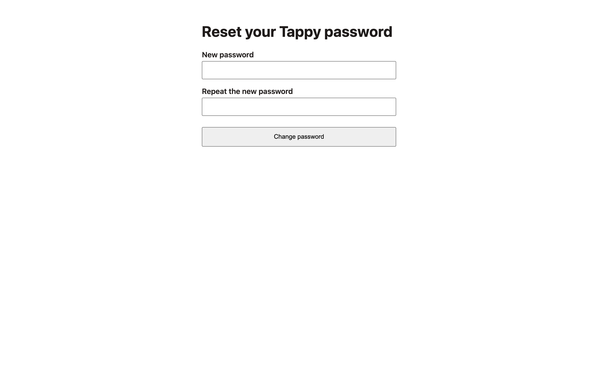
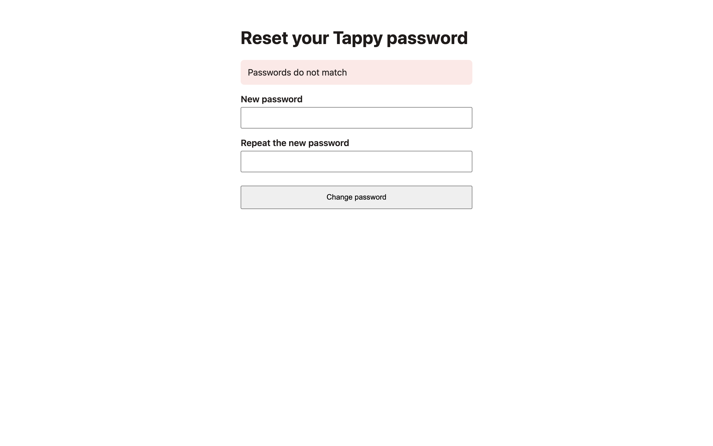
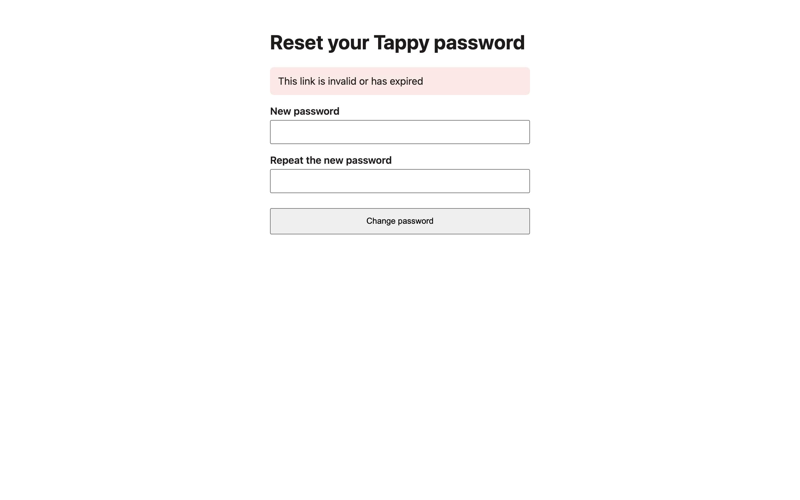

# Evidencia — B42 Restablecer contraseña y revocar sesiones anteriores

Ticket: [#50](https://github.com/luisjrez/Tappy/issues/50) · Historia: [H2 #2](https://github.com/luisjrez/Tappy/issues/2) · Protocolo: [TICKET_QUALITY_PROTOCOL](../planning/TICKET_QUALITY_PROTOCOL.md) · Manifiesto: [B42-password-reset.toml](B42-password-reset.toml)

> Stack lateral encima de B41 (#60). B42 no tiene casos externos propios: todos sus AC se verifican con Postgres y correo simulado/Mailpit. La rama hereda el manifiesto de B41, que sigue BLOCKED por su TC06; por eso el CI de esta rama también falla en `evidence` hasta desbloquear B41.

## Revisiones y escenario

- Ticket, UC/AC/TC y comprobación: B42-UC01–UC06, B42-AC01–AC06, B42-TC01–TC06, B42-VC01.
- Modalidad: **resultado inicial** (página `/password-reset` y `POST /auth/password-reset/confirm` nuevos). Contratos existentes sin diferencias; nuevo `password-reset-confirm-invalid` (400) aprobado en `d0f2b84`.
- Base: rama B41 (PR #60). Revisiones: candidato `d0f2b84` → correcciones `a48d9db` → código final `203fb0f` (política de referrer). Tests y checks corresponden a `203fb0f`; capturas 03 y 04 recapturadas sobre `203fb0f`; 01 y 02 (formulario sin token en la URL y confirmación distinta) no cambian salvo el `minlength` tomado de la configuración.
- Entorno: macOS, Colima + Compose (Postgres 18.6, Mailpit v1.33.0), Python 3.14.8; Chrome (DevTools MCP), 1280×800. Fecha: 2026-11-20. Ejecutor: sesión local de desarrollo del autor del PR.
- Datos: identidad y frases sintéticas; tokens redactados.

## Diseño

- `tappy.identity.reset.confirm_password_reset` (caso de uso único para API y formulario), en una transacción:
  1. `lock_owner`: primero bloquea la identidad dueña del enlace (`FOR NO KEY UPDATE`) y exige que esté activa. Así dos confirmaciones del mismo usuario, aunque usen enlaces distintos, se serializan sin deadlock (el orden anterior, enlace→identidad, provocaba un deadlock con 500).
  2. `pending_reset`: enlace por digest, sin consumir, sin invalidar y vigente, con `FOR UPDATE`; el token es lo único que identifica al titular y el esquema rechaza campos extra (`role`, `email`, …).
  3. `PasswordPolicy` única (NFKC, longitudes desde `TAPPY_PASSWORD_MIN_LENGTH`/`TAPPY_PASSWORD_MAX_LENGTH`, lista de comunes), compartida por bootstrap, alta de operadores (API y panel) y reset; si falla, nada se consume.
  4. Cambia el hash, consume el enlace, invalida los demás enlaces pendientes, revoca todas las sesiones (API y panel comparten `access_sessions`) y encola el aviso «Your Tappy password was changed» (sin contraseña) en el outbox de B41.
- Migración `0006`: `consumed_at`, `invalidated_at` en `password_reset_requests`.
- API: `POST /auth/password-reset/confirm` → `204` (sin tokens: no hay login automático), `400` enlace inválido, `422` política o campos extra.
- Página pública `GET/POST /password-reset` (fuera del panel, plantilla propia): sin recursos de terceros, `Referrer-Policy: same-origin`, `Cache-Control: no-store`, `nosniff`, CSP con nonce (`default-src 'none'`). Con `no-referrer` los navegadores envían `Origin: null` en el POST del formulario (lo destapó el recorrido real en Chrome), así que se usa `same-origin`: el token va en el fragmento, que nunca viaja en `Referer`, y a otros orígenes no se envía referrer. El POST exige un `Origin` igual a `TAPPY_PUBLIC_BASE_URL` cuando la cabecera viene (`null` o ajeno → 403) y valida campos con un modelo Pydantic (longitudes acotadas). El GET no recibe el token (va en el fragmento), así que no puede consumirlo; un script con nonce lo lee, lo quita de la barra (`history.replaceState`) y lo guarda en `sessionStorage` solo para reintentos tras un error; se borra al terminar con éxito o ante un enlace inválido. La página de éxito enlaza al login del panel. El formulario pide confirmación de la contraseña; los errores no repiten token ni contraseña.
- Protección del formulario: no hay sesión que suplantar (el token secreto autoriza y solo cambia la contraseña de su titular); además se rechaza un `Origin` nulo o ajeno.
- Fuera de alcance (ticket): pantallas móviles, cambio de correo, recuperación de cuentas comprometidas, MFA.

## Trazabilidad UC → AC → TC → test

| UC | AC | TC | Test real | Resultado |
| --- | --- | --- | --- | --- |
| B42-UC01 | B42-AC01 | B42-TC01 | `test_valid_token_sets_new_password_without_signing_in` (204 sin tokens; nueva entra, anterior falla; misma referencia y rol); `test_form_changes_password_and_points_back_to_sign_in` | PASS |
| B42-UC02 | B42-AC02 | B42-TC02 | `test_invalid_links_never_change_the_password[expired, altered, reused]`; `test_concurrent_confirmations_change_the_password_once` (4 hilos: un 204, tres 400); `test_concurrent_different_links_of_one_identity_never_crash` (3 enlaces distintos en paralelo: un 204, dos 400, ningún 500) | PASS |
| B42-UC03 | B42-AC03 | B42-TC03 | `test_deactivated_identity_is_not_reactivated_by_a_pending_link`; `test_extra_identity_fields_are_rejected_without_changes[role, email, user_id, reference]` (con sesión de otra operadora en la petición); el hash de la desactivada no cambia | PASS |
| B42-UC04 | B42-AC04 | B42-TC04 | `test_reset_revokes_every_session_and_pending_link` (access y refresh previos → 401; enlace anterior pendiente → 400; cero sesiones activas); `test_reset_revokes_panel_sessions_and_keeps_the_role` (sesión del panel de un admin cerrada; nuevo login conserva rol admin) | PASS |
| B42-UC05 | B42-AC05 | B42-TC05 | `test_policy_violation_keeps_the_link_usable`; `test_failure_inside_the_transaction_leaves_everything_unchanged` (fallo inducido en el aviso: hash, consumo y sesiones intactos; el enlace sigue sirviendo); `test_form_errors_are_safe_and_change_nothing[mismatch, tampered]`; `test_oversized_form_fields_are_rejected`; `test_password_policy_comes_from_configuration` | PASS |
| B42-UC06 | B42-AC06 | B42-TC06 | `test_opening_the_page_does_not_consume_the_link` (incluso con `?token=` en la URL); `test_reset_page_is_self_contained_and_never_leaks_the_link`; `test_change_notice_is_queued_without_password_and_its_failure_keeps_the_change`; `test_invalid_link_clears_the_stored_token`; `test_foreign_origin_cannot_submit_the_form`; `test_null_or_foreign_origin_is_rejected`; `test_same_origin_browser_submission_is_accepted` | PASS |

## TDD

| Comportamiento | Red | Green |
| --- | --- | --- |
| Confirmación por API | `assert 404 == 204` | `confirm_password_reset`, migración `0006`, endpoint |
| Página pública | 4 fallos (sin ruta, sin cabeceras, sin formulario) | `reset_page.py` + plantilla |
| Enlace de un solo uso | Retirando `consumed_at IS NULL`: fallan `…[reused]` y la concurrencia | Filtro restaurado |
| Vencimiento | Sin `expires_at > now`: falla `…[expired]` | Filtro restaurado |
| Concurrencia | Sin `FOR UPDATE`: falla `…concurrent…` | Bloqueo de fila |
| Cuenta desactivada | Sin chequeo de estado: falla `…not_reactivated…` | `active_owner` |
| Otros enlaces y sesiones | Sin invalidar enlaces / sin revocar sesiones: falla `…revokes_every_session…` | `invalidate_other_links`, `revoke_identity_sessions` |
| Política antes de consumir | Consumir y confirmar antes de validar: fallan 12 tests | Orden: política → cambios |
| Correcciones de review | Tests nuevos en Red: deadlock entre enlaces distintos del mismo usuario (500), política no configurable, éxito sin enlace al login, token sin borrar ante enlace inválido, `Origin` ajeno aceptado, campos sobredimensionados (6 fallos) | `lock_owner` primero, `PasswordPolicy` desde configuración, plantilla y modelo de formulario |
| Orden de bloqueo | Restaurando el orden enlace→identidad: falla `…different_links…` 3/3 | Identidad primero, 3/3 verde |
| `Origin: null` del navegador (recorrido real) | El formulario real respondía «The form could not be processed» (403) | `Referrer-Policy: same-origin`; tests de `null`/ajeno (403) y mismo origen (200) |

Los tests de TC02–TC06 pasaron a la primera porque el Green de TC01 implementó el caso de uso completo; el Red de cada comportamiento se observó retirándolo temporalmente (todas las mutaciones revertidas).

## B42-VC01 — Resultado inicial

Recorrido real (servidor `python -m tappy` con `TAPPY_PUBLIC_BASE_URL=http://127.0.0.1:8774`, enlace generado por el worker y leído de Mailpit):

```text
GET /password-reset → 200
referrer-policy: same-origin (no-referrer en la primera captura; cambiado por el hallazgo de Origin: null)
cache-control: no-store
x-content-type-options: nosniff
content-security-policy: default-src 'none'; script-src 'nonce-…'; style-src 'nonce-…'; form-action 'self'; base-uri 'none'; frame-ancestors 'none'
```

| Paso | Captura / resultado |
| --- | --- |
| Abrir `…/password-reset#token=<redactado>` |  La barra queda en `/password-reset`: el token ya no está en la URL |
| Confirmación distinta |  «Passwords do not match» (422); nada se consume |
| Contraseña válida (navegador real, `Origin` comprobado) |  «Your password was changed…» con enlace al login del panel; sin sesión nueva |
| Enlace ausente o inválido |  «This link is invalid or has expired» (400); el token guardado se borra |

```text
GET /auth/me con la sesión abierta antes del cambio → 401
POST /auth/login contraseña anterior               → 401 {"detail":"Invalid email or password"}
POST /auth/login contraseña nueva                  → 200
POST /auth/password-reset/confirm reutilizando     → 400 {"detail":"This link is invalid or has expired"}
$ python -m tappy.notifications deliver            → sent=1
Aviso en Mailpit: "Your Tappy password was changed" — no contiene la contraseña
Log de acceso: "GET /password-reset HTTP/1.1" (sin token); 0 coincidencias del token en el log
```

Datos de prueba y buzón limpiados al terminar. Estado VC01: **PASS** (resultado inicial).

## Checks sobre `203fb0f`

`uv run python -m quality.check`: format, lint, types, hygiene, migrations (`0006` sin drift), tests (`192 passed`), api (10 contratos sin diferencias) en PASS; `evidence`: B42 pendiente solo de aprobar el review; B41 BLOCKED (TC06).

## Supresiones

Sin supresiones nuevas.

## Umbral

AC PASS / AC aplicables = 6/6 = **100%** (B42 propio). El gate de la rama sigue fallando por el manifiesto heredado de B41 (BLOCKED por TC06).

## Review Standards/Spec

Ronda 1 sobre `d0f2b84`, sin violaciones duras; correcciones en `a48d9db` y `203fb0f`.

| Eje | Hallazgo | Resolución |
| --- | --- | --- |
| Spec | Deadlock entre dos enlaces distintos del mismo usuario (500) | Identidad bloqueada primero; test concurrente + mutación |
| Spec | Política de contraseña fija en código y en la plantilla | `PasswordPolicy` desde `TAPPY_PASSWORD_MIN_LENGTH`/`MAX_LENGTH`, compartida; plantilla desde configuración |
| Spec | TC04 sin sesión de panel ni rol tras el nuevo login | `test_reset_revokes_panel_sessions_and_keeps_the_role` |
| Spec | TC03 sin sesión de operador ajena; desactivada sin comprobar hash | Test con bearer de otra operadora; hash sin cambios |
| Spec | VC01 sin captura de enlace inválido; éxito sin vuelta al login | Captura 04; enlace al login del panel |
| Spec | Formulario sin protección de origen | `Origin` nulo/ajeno → 403; con `no-referrer` el navegador enviaba `null` → `same-origin` |
| Spec / Standards | Token en `sessionStorage` tras errores | Se borra ante enlace inválido |
| Standards | Digest SHA-256 repetido en tres sitios | `tappy.identity.tokens.token_digest` |
| Standards | `RecordingTransport`/`recovery_token` duplicados en tests | `tests/support` |
| Standards | Formulario sin validación de frontera | Modelo `ResetForm` (longitudes acotadas) |
| Standards | `action` y longitudes literales en la plantilla | `RESET_PATH` y política desde el contexto |
| Standards | Mapeo de errores repetido entre API y página | Se conserva: uno devuelve JSON y otro HTML |
| Standards | `RecoveryService.confirm` como Middle Man; callback de aviso con un solo uso productivo | Se conservan: el servicio agrupa sellador y políticas; el callback permite probar la atomicidad con un fallo inducido (test registrado como inyección en frontera interna) |

Re-revisión: pendiente.
